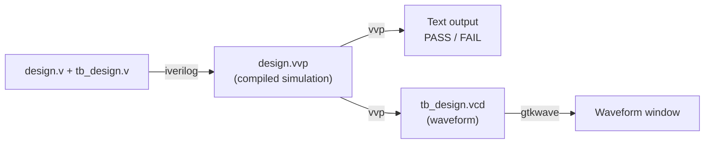

# 00 - Setup: install the tools and check them

**Reading time:** about 30 minutes (including the installation).

## Goals

After this chapter you can:

- install Icarus Verilog and GTKWave on Linux or Windows,
- compile and run a design with its testbench,
- open a waveform and find a signal in it,
- understand the testbench pattern that every chapter uses,
- run the examples and the exercises of this repository.

## 1. The tools

We use only free tools.

| Tool | What it does | Needed? |
|---|---|---|
| **Icarus Verilog** (`iverilog`, `vvp`) | Compiles Verilog (`iverilog`) and runs the simulation (`vvp`) | Yes |
| **GTKWave** | Shows waveform files (`.vcd`) | Yes |
| **VeriNest** | A small learning IDE: editor, explained errors, simulation and waveforms in one window | Optional |
| **Verilator** | A very strict linter. It finds mistakes that Icarus accepts. | Optional |
| **Yosys** | A synthesis tool. It tells you if your code can become hardware. | Optional |

Icarus works in two steps. This is different from many software compilers,
so it is worth seeing once:



## 2. Install on Linux (Debian, Ubuntu, Linux Mint)

Open a terminal and run:

```bash
sudo apt update
sudo apt install iverilog gtkwave
```

Optional extras for lint and synthesis checks:

```bash
sudo apt install verilator yosys
```

Check the installation:

```bash
iverilog -V 2>&1 | head -n 1    # e.g. Icarus Verilog version 12.0 (stable)
which vvp gtkwave               # both should print a path
```

Version 11 or newer is fine. Ubuntu 22.04 ships version 11.
Ubuntu 24.04 and Linux Mint 22 ship version 12.

If `iverilog` prints `command not found`, the install did not work.
Run `sudo apt install iverilog` again and read the error message.

## 3. Install on Windows

You have two good options.

**Option A (recommended): WSL.** WSL runs a real Ubuntu inside Windows.

1. Open PowerShell as administrator and run `wsl --install`.
2. Restart the computer and open "Ubuntu" from the Start menu.
3. Follow the Linux steps above inside the Ubuntu terminal.

Everything in this repository (the Makefile and the scripts) works in WSL
without changes. GTKWave opens as a normal window on Windows 11.

**Option B: native installer.** A Windows build of Icarus Verilog that also
includes GTKWave is available at <https://bleyer.org/icarus/>.

1. Download the newest installer and run it.
2. In the installer, tick the option that adds the tools to `PATH`.
3. Open a new Command Prompt and run `iverilog -V`.

With option B you can run `iverilog` and `vvp` by hand. The `make` and
`scripts/*.sh` helpers need a Unix shell, for example Git Bash.

## 4. VeriNest: a learning IDE (optional)

[VeriNest](https://github.com/mortezapourhoseini/verinest) is a small, offline
IDE for practising Verilog. It uses Icarus Verilog inside, explains every error
in plain English with a suggested fix, and has a built-in waveform viewer.
To install it on Linux, clone the repository and run its installer:
`git clone https://github.com/mortezapourhoseini/verinest.git`, then
`cd verinest && ./install.sh`. The installer also installs `iverilog`.
Check the install with `verinest --selftest`. It should end with `ALL EXAMPLES PASSED`.
On Windows, download the `Setup.exe` from the VeriNest releases page. It already includes Icarus Verilog.
To run an example, start `verinest`, click the book icon, pick an example and press **F5**.
VeriNest compiles, runs the testbench and opens the **Waveform** tab for you.
VeriNest projects are plain folders in `~/VeriNest/projects/`, so you can copy any example folder of this repository there and run it with F5.
For details, see the [VeriNest README](https://github.com/mortezapourhoseini/verinest#readme).

## 5. Get this repository

```bash
git clone https://github.com/mortezapourhoseini/verilog-by-practice.git
cd verilog-by-practice
```

The folders are:

| Folder | Content |
|---|---|
| `docs/` | One chapter per file. Read them in order. |
| `examples/<chapter>/<example>/` | A design, its testbench (`tb_*.v`) and a short README |
| `exercises/<chapter>/<exercise>/` | A problem statement, a file to complete and a ready testbench |
| `solutions/<chapter>/<exercise>/` | One possible solution for each exercise. Try first! |
| `scripts/` | Helper scripts used by `make` and by the CI |

## 6. Check your setup (under five minutes)

The first example is a 2-to-1 multiplexer. It is in
[`examples/00-setup/mux2/`](../examples/00-setup/mux2/).

### Step 1: compile

```bash
cd examples/00-setup/mux2
iverilog -g2001 -Wall -o mux2.vvp mux2.v tb_mux2.v
```

What the options mean:

- `-g2001` uses the Verilog-2001 language rules. This repository uses Verilog-2001.
- `-Wall` turns on useful warnings. Read them. They often point to real bugs.
- `-o mux2.vvp` is the output file. Without `-o`, the file is called `a.out`.
- At the end, list **all** source files: the design and the testbench.

No output means success.

### Step 2: run

```bash
vvp mux2.vvp
```

You should see:

```text
VCD info: dumpfile tb_mux2.vcd opened for output.
PASS: tb_mux2
tb_mux2.v:63: $finish called at 80000 (1ps)
```

The important line is `PASS: tb_mux2`. The time `80000 (1ps)` is 80 ns,
because the testbench waits 10 ns for each of the 8 input combinations.

### Step 3: look at the waveform

```bash
gtkwave tb_mux2.vcd &
```

In GTKWave:

1. In the top-left panel (SST), click `tb_mux2`.
2. In the panel below it, select the signals `a`, `b`, `sel` and `y`.
3. Click **Append** (or drag them to the "Signals" area).
4. Press the **Zoom Fit** button in the toolbar to see the whole simulation.

You should see that `y` copies `a` while `sel` is 0, and copies `b` while `sel` is 1.

### Step 4: run everything

Go back to the repository root and run all examples and solutions:

```bash
cd ../../..
make
```

At the end you see a summary line: `Summary: <N> passed, 0 failed`.
The same command runs in the CI on every push.

Other useful commands:

```bash
make run DIR=examples/00-setup/mux2      # run one example
make wave DIR=examples/00-setup/mux2     # open its waveform
make clean                               # delete build outputs and .vcd files
```

## 7. The testbench pattern used in this repository

A **testbench** is Verilog code that is not hardware. It creates input values,
drives them into the design, and checks the outputs. The design under test is
often called the **DUT** (device under test).

Every testbench here has the same five parts. Open
[`tb_mux2.v`](../examples/00-setup/mux2/tb_mux2.v) and find them:

```verilog
module tb_mux2;                 // a testbench has no ports
  reg  a, b, sel;               // 1. signals: we drive DUT inputs -> reg
  wire y;                       //    the DUT drives outputs -> wire
  integer errors;

  mux2 dut (.a(a), .b(b),       // 2. connect the DUT by port name
            .sel(sel), .y(y));

  initial begin                 // 3. record a waveform
    $dumpfile("tb_mux2.vcd");
    $dumpvars(0, tb_mux2);
  end

  initial begin                 // 4. stimulus and checks
    errors = 0;
    ...
    if (y !== expected) errors = errors + 1;
    ...
    if (errors == 0) begin      // 5. one clear result line
      $display("PASS: tb_mux2");
      $finish;
    end else begin
      $display("FAIL: tb_mux2 (%0d errors)", errors);
      $fatal(1, "tb_mux2 failed");
    end
  end
endmodule
```

Why this pattern?

- **Self-checking.** The testbench decides PASS or FAIL. You do not need to
  read a waveform to know if the design works. Waveforms are for debugging.
- **One result line.** Scripts and the CI look for a line that starts with
  `PASS` or `FAIL`.
- **Exit status.** `$fatal(1, ...)` stops the simulation and makes `vvp` exit
  with status 1. So `make` and the CI see the failure even if nobody reads the text.
  `$fatal` comes from SystemVerilog, but Icarus accepts it in Verilog-2001 mode.
  It is the only non-2001 feature in the main chapters.
- **`!==` instead of `!=`.** If the output is `x` (unknown), `y != 1'b1`
  is also `x`, and an `if` treats `x` as false. So `!=` silently hides the bug.
  `!==` compares the bits exactly, including `x` and `z`. Chapter 03 explains this.

## 8. How to do the exercises

Each exercise folder has:

- `README.md`: the problem statement,
- a `.v` file with the module ports and a `TODO` comment,
- a testbench `tb_*.v` that is already written.

Workflow:

```bash
# 1. read the problem
cat exercises/00-setup/ex1-mux2-4bit/README.md
# 2. edit the .v file
# 3. run the testbench on your code
make run DIR=exercises/00-setup/ex1-mux2-4bit
```

The file you get compiles, but the testbench fails until you write the logic.
When you see `PASS`, compare with the file in `solutions/`. There is often more
than one good solution.

## 9. Common mistakes

### Mistake 1: forgetting a source file

Wrong:

```bash
iverilog -o mux2.vvp tb_mux2.v
```

```text
tb_mux2.v:22: error: Unknown module type: mux2
```

Why: the testbench uses the module `mux2`, but the compiler never saw it.
Fix: give every file.

```bash
iverilog -g2001 -Wall -o mux2.vvp mux2.v tb_mux2.v
```

### Mistake 2: editing the code but not compiling again

`vvp` runs the old `.vvp` file. Your change has no effect, and you get confused.
Fix: always run `iverilog` again after an edit, or use `make run DIR=...`,
which does both steps.

### Mistake 3: a testbench that never ends

Wrong:

```verilog
initial begin
  a = 0; b = 1; sel = 0;
  #10 sel = 1;
  #10;
  // no $finish
end
always #5 clk = ~clk;   // a clock keeps the simulation alive forever
```

Why: a clock generator is an endless loop. Without `$finish`, `vvp` never stops.
Fix: end every testbench with `$finish` (or `$fatal` on failure). If a run hangs,
press `Ctrl+C`, then type `finish` and press Enter at the `>` prompt.

### Mistake 4: running vvp from another folder

The testbench writes `tb_mux2.vcd` and reads data files (chapter 08) using paths
relative to the **current folder**. If you run `vvp` from another folder, files
are written to, or searched in, the wrong place.
Fix: run `vvp` inside the example folder. `make run` does this for you.

### Mistake 5: checking with `!=`

Wrong:

```verilog
if (y != expected) errors = errors + 1;   // y = x is NOT counted
```

Fix:

```verilog
if (y !== expected) errors = errors + 1;  // y = x IS counted
```

## 10. Exercises

1. [`ex1-mux2-4bit`](../exercises/00-setup/ex1-mux2-4bit/): change the 1-bit
   multiplexer into a 4-bit wide one.
2. [`ex2-half-adder`](../exercises/00-setup/ex2-half-adder/): write a half adder
   (`sum`, `carry`) and run the given testbench.
3. (No solution needed.) Break `mux2.v` on purpose, as described in its README,
   and look at the `ERROR` lines. Then open the waveform and find the time where
   `y` is wrong.

## Summary

- `iverilog` compiles, `vvp` runs, `gtkwave` shows waveforms.
- Always list all source files and compile again after each change.
- Every testbench here is self-checking and prints `PASS: ...` or `FAIL: ...`.
- `make` runs all tests. `make run DIR=...` runs one.

Next: [01 - Modules and ports](01-modules-and-ports.md).
