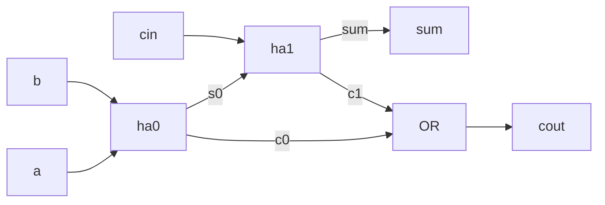
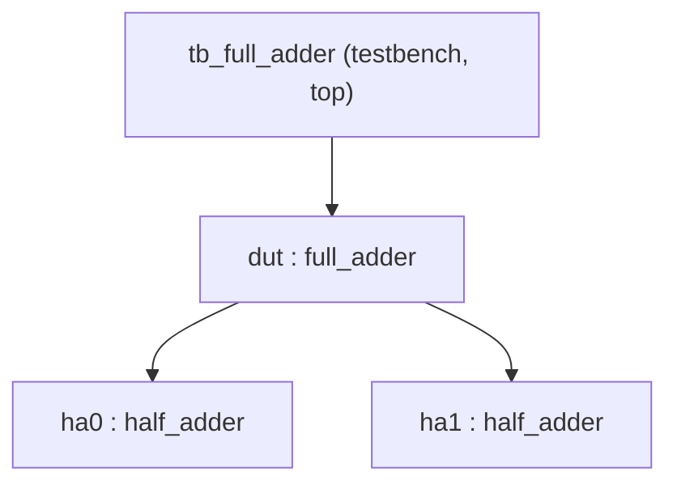

# 01 - Modules and ports

**Reading time:** about 30 minutes.

## Goals

After this chapter you can:

- write a module header in the Verilog-2001 style,
- choose the right port direction and type,
- create instances of a module and connect them by name,
- build a design from smaller modules (hierarchy),
- avoid the classic mistakes: position-based connections and implicit wires.

## 1. A module is a box of hardware

A Verilog **module** describes one block of hardware with inputs and outputs.
It is **not** like a function in C:

- A C function runs when you call it, and then it is gone.
- A module **instance** is a piece of hardware. It exists all the time and
  works in parallel with every other instance.

If you use a module three times, you get three copies of the hardware.
Keep this picture in mind. It explains many rules in this repository.

## 2. The module header

Verilog-2001 lets you declare the ports inside the parentheses. This is the
style we use everywhere (it is called the *ANSI style*):

```verilog
module half_adder (
  input  wire a,       // direction, type, name
  input  wire b,
  output wire sum,
  output wire carry    // no comma after the last port
);                     // the header ends with ");"

  assign sum   = a ^ b;
  assign carry = a & b;

endmodule              // no semicolon after endmodule
```

You will still see the older Verilog-1995 style in old code and books.
The port names are listed first, and their directions are declared again in
the body:

```verilog
module half_adder (a, b, sum, carry);   // old style
  input  a, b;
  output sum, carry;
  assign sum   = a ^ b;
  assign carry = a & b;
endmodule
```

Both styles describe the same hardware. The new style is shorter and you
cannot forget a declaration. Use it in new code.

### Port directions

| Direction | Meaning | Typical use |
|---|---|---|
| `input` | The module reads it | Data in, clock, reset |
| `output` | The module drives it | Results |
| `inout` | Both, through a tri-state buffer | Only for real bidirectional pins (for example an I2C data line) |

Inside FPGA and chip designs, almost all ports are `input` or `output`.
Avoid `inout` inside a design.

### Port types: `wire` or `reg`

The port type tells **how the module drives the signal** (chapter 02 explains this in depth):

- `input` ports are always `wire`. A module cannot drive its own input.
- An `output` is `wire` if you drive it with `assign` or from an instance.
- An `output` is `reg` if you assign it inside an `always` block.

```verilog
module example (
  input  wire       a,
  output wire       y1,   // driven by assign
  output reg  [3:0] y2    // driven inside always
);
  assign y1 = ~a;
  always @(*) y2 = {4{a}};
endmodule
```

`reg` does **not** mean "register" (flip-flop). It only means "assigned in a
procedural block". This is one of the most confusing names in Verilog.

### Vector ports

A bus is declared with a range `[msb:lsb]`:

```verilog
input  wire [7:0] data,   // 8 bits: data[7] ... data[0]
output wire [3:0] nibble
```

We always write `[N-1:0]`: the most significant bit has the highest index.

## 3. Instances and port connections

To use a module inside another module, write an **instance**:

```verilog
//  module name   instance name
    half_adder    ha0 (
      .a     (x),     // .port_name (signal_in_this_module)
      .b     (y),
      .sum   (s),
      .carry (c)
    );
```

- The **module name** says what hardware to build.
- The **instance name** (`ha0`) is the name of this copy. Every instance needs a unique name.
- `.a(x)` means: the port `a` of the instance is connected to the signal `x`
  of the parent module.

This is a **named connection**. The order of the lines does not matter.

### Named versus positional connections

Verilog also allows connections by position:

```verilog
half_adder ha0 (x, y, s, c);   // works, but dangerous
```

The first signal goes to the first port, and so on. It is short, but it breaks
silently when somebody changes the port order of `half_adder`. Use named
connections. All code in this repository does.

### Unconnected ports

```verilog
full_adder fa (.a(a), .b(b), .cin(1'b0), .sum(s), .cout());
```

- `.cout()` leaves an output unconnected. That is fine: the output is not used.
- An **input** must never be left unconnected. An unconnected input has the
  value `z` (floating), and the logic behind it becomes `x`. Connect it to a
  constant such as `1'b0` if you do not need it.

## 4. Example: a full adder from two half adders

Files: [`examples/01-modules-and-ports/full-adder/`](../examples/01-modules-and-ports/full-adder/)

A full adder adds three bits. We can build it from two half adders and an OR gate:



```verilog
module full_adder (
  input  wire a,
  input  wire b,
  input  wire cin,
  output wire sum,
  output wire cout
);

  wire s0;   // internal wires connect the instances
  wire c0;
  wire c1;

  half_adder ha0 (.a(a),  .b(b),   .sum(s0),  .carry(c0));
  half_adder ha1 (.a(s0), .b(cin), .sum(sum), .carry(c1));

  assign cout = c0 | c1;

endmodule
```

Notes:

- `s0`, `c0` and `c1` are **internal wires**. They exist only inside `full_adder`.
- The output port `sum` of `full_adder` is connected directly to the `sum`
  port of `ha1`. The same name on both sides is fine and common.
- The order of `ha0`, `ha1` and `assign` in the file does not matter.
  They are all hardware that works at the same time.

Run it:

```bash
make run DIR=examples/01-modules-and-ports/full-adder
```

### Hierarchy and hierarchical names

The design now forms a tree:



The module that nobody instantiates is the **top** module. Here it is the
testbench. Icarus finds it by itself.

Every signal has a **hierarchical name**: `tb_full_adder.dut.ha0.sum` is the
`sum` wire inside instance `ha0`. The testbench prints `dut.s0` this way.
Hierarchical names are great for debugging and in GTKWave, where you click
through the same tree. Do not use them inside synthesizable design code.

## 5. Example: a 4-bit ripple-carry adder

Files: [`examples/01-modules-and-ports/ripple-adder4/`](../examples/01-modules-and-ports/ripple-adder4/)

Four full adders in a chain make a 4-bit adder. The carry out of bit `i`
goes into the carry in of bit `i+1`:

```verilog
`default_nettype none

module ripple_adder4 (
  input  wire [3:0] a,
  input  wire [3:0] b,
  input  wire       cin,
  output wire [3:0] sum,
  output wire       cout
);

  wire [4:0] c;          // c[i] = carry into bit i
  assign c[0] = cin;

  full_adder fa0 (.a(a[0]), .b(b[0]), .cin(c[0]), .sum(sum[0]), .cout(c[1]));
  full_adder fa1 (.a(a[1]), .b(b[1]), .cin(c[1]), .sum(sum[1]), .cout(c[2]));
  full_adder fa2 (.a(a[2]), .b(b[2]), .cin(c[2]), .sum(sum[2]), .cout(c[3]));
  full_adder fa3 (.a(a[3]), .b(b[3]), .cin(c[3]), .sum(sum[3]), .cout(c[4]));

  assign cout = c[4];

endmodule

`default_nettype wire
```

Notes:

- You can connect **one bit** of a vector (`a[0]`) to a 1-bit port.
- A vector `c[4:0]` for the carries is easier to read than five separate wires.
- The testbench checks all 512 input combinations. For small blocks, an
  exhaustive test is cheap and gives full confidence.
- Writing four nearly equal lines is boring and error-prone. Chapter 07 shows
  how `generate` writes them in a loop.

### What is `` `default_nettype none ``?

By default, if you use a name that you never declared in a port connection,
Verilog quietly creates a new 1-bit `wire` with that name. This is called an
**implicit net**. A typo then becomes a new, unconnected wire, and there is no
error. (Icarus 12 prints a warning with `-Wall`, but warnings are easy to miss
and other tools may stay silent.) The directive `` `default_nettype none `` turns this off: undeclared
names become errors.

The directive works for all following files in the same compile, so we switch
it back with `` `default_nettype wire `` at the end of the file. This keeps other
files (for example old code) working.

## 6. Common mistakes

### Mistake 1: positional connection in the wrong order

Wrong:

```verilog
// Port order of half_adder is (a, b, sum, carry).
half_adder ha0 (x, y, c, s);   // sum and carry are swapped!
```

Why: it compiles without any message. The design is wrong, and the reason is
hidden in the order of four names.

Fix: connect by name. The order no longer matters, and the mistake is visible.

```verilog
half_adder ha0 (.a(x), .b(y), .sum(s), .carry(c));
```

### Mistake 2: a typo creates an implicit wire

Wrong:

```verilog
wire carry_mid;
half_adder ha0 (.a(a),  .b(b),  .sum(s0),  .carry(cary_mid));  // typo
half_adder ha1 (.a(s0), .b(ci), .sum(sum), .carry(c1));
assign cout = carry_mid | c1;   // carry_mid is never driven -> z -> x
```

Why: `cary_mid` is a new implicit 1-bit wire. `carry_mid` has no driver.
Icarus compiles it. With `-Wall` you get only a warning:

```text
full_adder.v:3: warning: implicit definition of wire 'cary_mid'.
```

Fix: put `` `default_nettype none `` at the top of the file. The typo becomes an error:

```text
full_adder.v:3: error: Net cary_mid is not defined in this context.
```

### Mistake 3: width mismatch on a port

Wrong:

```verilog
wire [3:0] s;
half_adder ha0 (.a(a), .b(b), .sum(s), .carry(c));   // 4-bit signal, 1-bit port
```

Why: Verilog connects the low bit `s[0]` and fills the other bits with 0.
The code compiles, but `s[3:1]` is always 0, which is probably not what you meant.
Icarus prints a warning (even without `-Wall`):

```text
warning: Port 3 (sum) of half_adder expects 1 bits, got 4.
       : Padding 3 high bits of the expression.
```

Fix: connect signals of the same width, for example `.sum(s[0])`.
Always compile with `-Wall` and read the warnings.

### Mistake 4: `output reg` driven by `assign`

Wrong:

```verilog
module inv (input wire a, output reg y);
  assign y = ~a;   // error: a reg cannot be driven by assign
endmodule
```

```text
error: reg y; cannot be driven by primitives or continuous assignment.
```

Fix: use `output wire y` with `assign`, or keep `reg` and use an `always` block.

### Mistake 5: driving an input inside the module

Wrong:

```verilog
module bad (input wire a, output wire y);
  assign a = 1'b0;   // the parent module drives a, not this module
  assign y = a;
endmodule
```

Why: now two drivers fight over the same wire (the parent and this module).
The result is `x` when they disagree.

Fix: never assign to an input. Create an internal signal if you need a changed version.

### Mistake 6: forgetting the semicolon after the header

Wrong:

```verilog
module half_adder (
  input  wire a,
  ...
  output wire carry
)            // missing ;
  assign sum = a ^ b;
```

Icarus reports only `syntax error` on the **next** line (the `assign`), which is confusing.
Fix: the header always ends with `);`.

## 7. Exercises

1. [`ex1-mux4-from-mux2`](../exercises/01-modules-and-ports/ex1-mux4-from-mux2/):
   build a 4-to-1 multiplexer from three `mux2` instances.
2. [`ex2-adder8`](../exercises/01-modules-and-ports/ex2-adder8/):
   build an 8-bit adder from two `ripple_adder4` instances.
3. (No solution.) In the full adder example, swap two lines of a positional
   connection on purpose. Run the testbench. Then rewrite it with named
   connections.

## Summary

- A module describes hardware. Each instance is a separate copy that runs in parallel.
- Use the Verilog-2001 header: `input wire`, `output wire`, `output reg`.
- `reg` means "assigned in an always block", not "flip-flop".
- Connect ports by name. Never leave an input unconnected.
- Use `` `default_nettype none `` to turn typos into errors, and compile with `-Wall`.

Next: [02 - Data types, vectors and literals](02-data-types-vectors-literals.md).
