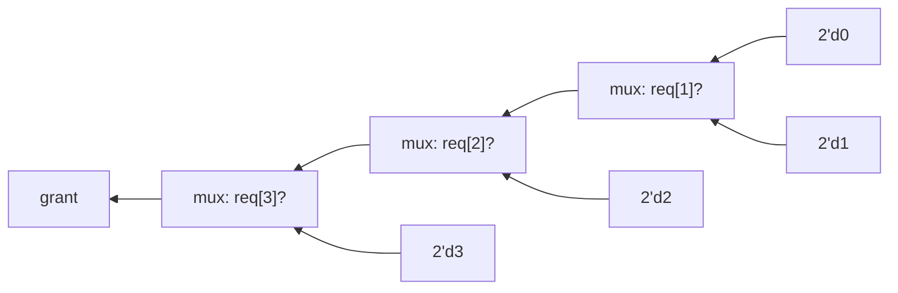

# 04 - Combinational logic

**Reading time:** about 30 minutes.

## Goals

After this chapter you can:

- describe combinational logic with `assign` and with `always @(*)`,
- use `if`, `case`, `casez` and `for` correctly in combinational blocks,
- explain why a latch appears, and prevent it every time,
- avoid incomplete sensitivity lists, combinational loops and multiple drivers.

## 1. What "combinational" means

A combinational circuit has **no memory**. Its outputs depend only on the
current inputs. Gates, multiplexers, decoders, adders and comparators are
combinational. Flip-flops, latches, counters and RAMs are not.

There are two ways to write combinational logic in Verilog:

```verilog
// 1. Continuous assignment: good for short expressions
assign y = sel ? b : a;

// 2. Combinational always block: good for if, case and loops
always @(*) begin
  if (sel) y = b;
  else     y = a;
end
```

Both describe the same multiplexer. Remember: with `assign`, `y` is a
`wire`. With `always`, `y` is a `reg`, and it is **still** combinational.

## 2. The rules for `always @(*)`

Three rules. If you follow them, a combinational `always` block always
becomes clean logic.

1. **Use `@(*)`.** The `*` means "every signal that this block reads".
   Do not write the list by hand (section 7 shows why).
2. **Use blocking assignments `=`.** Statements then run in order, like
   software, and later lines see the new values of earlier lines.
   (Non-blocking `<=` is for clocked blocks. Chapter 05 explains the difference.)
3. **Assign every output in every path.** Every signal written by the block
   must get a value no matter which `if` branch or `case` item runs.
   The easy way: give every output a **default value at the top**.

```verilog
always @(*) begin
  // rule 3: defaults first
  y     = 8'd0;
  valid = 1'b0;
  // then the real logic, which may override the defaults
  if (en) begin
    y     = data;
    valid = 1'b1;
  end
end
```

## 3. `if` and `else`: a chain of multiplexers

An `if` / `else if` chain has a **priority**: the first true condition wins.

```verilog
always @(*) begin
  if      (req[3]) grant = 2'd3;
  else if (req[2]) grant = 2'd2;
  else if (req[1]) grant = 2'd1;
  else             grant = 2'd0;
end
```

In hardware this is a chain of multiplexers. The first condition is the
closest to the output:



Long chains are slow, because the last condition passes through every
multiplexer. If the conditions cannot be true at the same time, a `case`
statement describes the logic better.

## 4. `case`

```verilog
always @(*) begin
  case (op)
    2'd0:       y = a + b;
    2'd1:       y = a - b;
    2'd2, 2'd3: y = a & b;      // several values on one line
    default:    y = 8'd0;
  endcase
end
```

- The expression `op` is compared with each item **from top to bottom**.
  The first match runs. There is no "fall through" like in C, and no `break`.
- Use `begin ... end` if an item has more than one statement.
- **Always write a `default`.** It catches values you forgot, and in
  simulation it also catches `x` and `z` on `op`.

### `casez`: don't care bits

In `casez`, a `?` (or `z`) in a case item matches any bit value.
This is perfect for priority logic:

```verilog
casez (req)
  4'b1???: grant = 2'd3;
  4'b01??: grant = 2'd2;
  4'b001?: grant = 2'd1;
  default: grant = 2'd0;
endcase
```

### Avoid `casex`

`casex` treats `x` as "don't care" too, **also in the input**. If `req`
becomes `x` because of a bug, `casex` happily matches the first item, and
the simulation hides the bug. Use `casez` instead.

## 5. `for` loops are copies of hardware

A `for` loop in a combinational block does not run "over time".
The compiler **unrolls** it: it writes out one copy of the loop body for each
value of the index. The number of iterations must be a constant.

```verilog
integer i;
always @(*) begin
  ones = 4'd0;
  for (i = 0; i < 8; i = i + 1)
    ones = ones + d[i];      // becomes 8 adders in a chain
end
```

This is the same as writing `ones = d[0] + d[1] + ... + d[7]`.
Loops make code short, but every iteration is real hardware. A loop with
1000 iterations makes 1000 copies.

## 6. Example: hex to seven-segment decoder

Files: [`examples/04-combinational-logic/seven-seg/`](../examples/04-combinational-logic/seven-seg/)

```verilog
always @(*) begin
  case (value)
    4'h0: seg = 7'b011_1111;   // {g, f, e, d, c, b, a}
    4'h1: seg = 7'b000_0110;
    ...
    4'hF: seg = 7'b111_0001;
    default: seg = 7'b000_0000;
  endcase
end
```

A complete `case` is a lookup table: synthesis turns it into a small ROM or
into gates. The testbench describes each digit by the names of its segments
(`"abdeg"` for 2) and converts them to bits. A reference in a different form
catches copy mistakes. It also draws the digit in the log:

```text
This is how the digit 2 looks:
   --
     |
   --
  |
   --
```

## 7. Example: priority encoder, two styles

Files: [`examples/04-combinational-logic/priority-encoder/`](../examples/04-combinational-logic/priority-encoder/)

Loop style:

```verilog
always @(*) begin
  idx   = 3'd0;
  valid = 1'b0;
  for (i = 0; i < 8; i = i + 1)
    if (req[i]) begin
      idx   = i;      // later iterations override: the highest bit wins
      valid = 1'b1;
    end
end
```

`casez` style:

```verilog
always @(*) begin
  valid = 1'b1;
  casez (req)
    8'b1???_????: idx = 3'd7;
    8'b01??_????: idx = 3'd6;
    ...
    8'b0000_0001: idx = 3'd0;
    default: begin idx = 3'd0; valid = 1'b0; end
  endcase
end
```

Both give the same hardware. The loop scales to any width. The `casez`
shows the truth table. The testbench checks both against one model.

## 8. Accidental latches

This is the most common bug in combinational Verilog.

```verilog
always @(*) begin
  if (en)
    q = d;
end
```

What is `q` when `en` is 0? The code does not say. Verilog's rule is that a
variable **keeps its value** until it is written again. To keep a value,
hardware needs memory. Synthesis builds a **latch**: a storage element that
is transparent while `en` is 1 and holds while `en` is 0.

Why is a latch bad here?

- You wanted combinational logic, and you got memory.
- Latches make timing analysis hard, and on FPGAs they are poorly supported.
- The output now depends on the **history** of the inputs.

A latch appears when **some path through the block does not assign an
output**. Typical causes:

- an `if` without `else`,
- a `case` without `default` that does not list every value,
- an output assigned in some branches but forgotten in others.

Three fixes, from best to acceptable:

```verilog
// Fix A (best): default values at the top
always @(*) begin
  q = 1'b0;
  if (en) q = d;
end

// Fix B: an else branch
always @(*) begin
  if (en) q = d;
  else    q = 1'b0;
end

// Fix C: if you really want a value to be kept, use a flip-flop
// with a clock (chapter 05), not a latch.
```

The [pitfalls example](../examples/04-combinational-logic/pitfalls/) shows the
latch holding its value in simulation:

```text
time (ns)   0    10   20
en          1    0    0
d           1    1    0
q_bad       1    1    1     <- holds 1 after en falls: a latch
q_fixed     1    0    0
```

Yosys also reports it (`make lint`):

```text
Latch inferred for signal `\latch_bad.\q' from process ...
```

Icarus does not warn about latches. Simulation runs as if nothing were wrong.
That is why the rule "default values first" is worth a habit.

## 9. Sensitivity lists

Before Verilog-2001, you had to list the inputs of a block by hand:

```verilog
always @(a or b or sel)
  y = sel ? b : a;
```

If you forget one signal, the **simulation** does not run the block when
that signal changes. But **synthesis ignores the list** and builds normal
logic. Now simulation and hardware disagree, and your tests are worthless.

```verilog
always @(a or b)      // sel is missing
  y = sel ? b : a;
```

```text
time (ns)  30   40   50
sel        0    1    1
a          0    0    1
y_bad      0    0    1     <- ignores the change of sel at 40
y_good     0    1    1
```

`always @(*)` (or `always @*`) builds the list for you. Use it for every
combinational block.

## 10. Common mistakes

### Mistake 1: the latch

Wrong:

```verilog
always @(*) begin
  case (sel)
    2'd0: y = a;
    2'd1: y = b;
    2'd2: y = c;
  endcase           // sel = 3: y is not assigned -> latch
end
```

Fix:

```verilog
always @(*) begin
  y = 8'd0;         // default
  case (sel)
    2'd0: y = a;
    2'd1: y = b;
    2'd2: y = c;
    default: y = 8'd0;
  endcase
end
```

### Mistake 2: reading a variable before writing it

Wrong:

```verilog
always @(*) begin
  y   = tmp & c;    // tmp still has the value from the LAST run of the block
  tmp = a | b;
end
```

Why: statements run in order. `y` uses an old `tmp`, so the block depends on
its own history: this is memory again. Simulation may even disagree with
synthesis.

Fix: compute values before you use them.

```verilog
always @(*) begin
  tmp = a | b;
  y   = tmp & c;
end
```

### Mistake 3: a combinational loop

Wrong:

```verilog
assign count = count + 1;   // no clock: the output feeds its own input
```

Why: this has no stable value. In simulation it either stays `x` forever or
loops forever at the same time step. In hardware it oscillates.

Fix: a value that changes step by step needs a register and a clock
(chapter 05):

```verilog
always @(posedge clk) count <= count + 1;
```

### Mistake 4: two blocks drive the same variable

Wrong:

```verilog
always @(*) if (a) y = 1'b1;
always @(*) if (b) y = 1'b0;
```

Why: in hardware, two circuits drive one wire. In simulation, whichever block
runs last wins, so the result depends on event order. Synthesis tools report
an error ("multiple drivers").

Fix: assign each variable in **one** block only:

```verilog
always @(*) begin
  y = 1'b0;
  if      (a) y = 1'b1;
  else if (b) y = 1'b0;
end
```

### Mistake 5: `casex` hides an x

Wrong:

```verilog
casex (opcode)          // if opcode is x, the first item matches!
  4'b1xxx: y = A;
  ...
```

Fix: use `casez` with `?`. An `x` on the input then goes to `default`,
where you can catch it.

## 11. Exercises

1. [`ex1-decoder3to8`](../exercises/04-combinational-logic/ex1-decoder3to8/):
   a 3-to-8 one-hot decoder with enable.
2. [`ex2-leading-zeros`](../exercises/04-combinational-logic/ex2-leading-zeros/):
   count the leading zeros of a byte.
3. [`ex3-fix-the-latch`](../exercises/04-combinational-logic/ex3-fix-the-latch/):
   find and fix three latch bugs in a traffic light decoder.

## Summary

- Combinational logic has no memory. Write it with `assign` or `always @(*)`.
- In `always @(*)`: use `=`, give **every output a default at the top**,
  and use `@(*)`, never a hand-written list.
- An output that is not assigned in some path becomes a latch.
- `if` chains have priority. `case` compares items from top to bottom.
  Use `casez`, not `casex`, and always write `default`.
- Loops are unrolled into copies of hardware.

Next: [05 - Sequential logic](05-sequential-logic.md).
