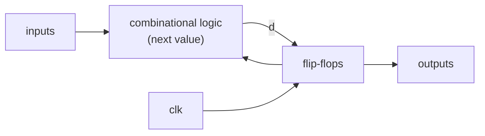

# 05 - Sequential logic

**Reading time:** about 30 minutes.

## Goals

After this chapter you can:

- write flip-flops with synchronous or asynchronous reset and with enable,
- explain the difference between blocking `=` and non-blocking `<=`,
  and use each in the right place,
- build counters, shift registers, synchronizers and edge detectors,
- test clocked designs with a clock, inputs on one edge and checks on the other.

## 1. Memory needs a clock

Sequential logic has **memory**: its outputs depend on the inputs **and** on
the stored state. In synchronous design, all state is kept in **flip-flops**
that change only at the rising edge of one clock.

Between two clock edges, the combinational logic computes the next values.
At the edge, all flip-flops take their new values at the same moment.



Two timing words you should know:

- **Setup time:** `d` must be stable for a short time **before** the clock edge.
- **Hold time:** `d` must stay stable for a short time **after** the edge.

The synthesis tool checks setup and hold for your design. Your job is to keep
the combinational logic between flip-flops short enough for the clock speed
(chapter 13 returns to this).

## 2. The flip-flop template

```verilog
always @(posedge clk) begin
  q <= d;
end
```

- `@(posedge clk)`: the block runs at each rising edge of `clk`.
- `<=`: the **non-blocking** assignment. Section 4 explains why it matters.
- `q` must be declared `reg`.

Everything in this chapter is a variation of these three lines.

## 3. Resets and enables

Files: [`examples/05-sequential-logic/dff-variants/`](../examples/05-sequential-logic/dff-variants/)

### Synchronous reset

```verilog
always @(posedge clk) begin
  if (rst) q <= 1'b0;
  else     q <= d;
end
```

The reset is checked only at the clock edge, like any other input.

### Asynchronous reset

```verilog
always @(posedge clk or negedge rst_n) begin
  if (!rst_n) q <= 1'b0;
  else        q <= d;
end
```

The reset edge is in the sensitivity list, so `q` is cleared **at once**,
without waiting for the clock. The structure must be exactly this:
`if (reset) ... else ...`, with the reset first. The `_n` suffix means
"active low": the reset is active when the signal is 0.

```text
time (ns)  20   21   22   23   24   25   26
clk        0    0    0    0    0    1    1     (rising edge at 25)
rst/rst_n  -    -    on   on   on   on   on
q_sync     1    1    1    1    1    0    0     <- waits for the edge
q_async    1    1    0    0    0    0    0     <- clears at once
```

Which one should you use? Both are common. FPGA vendors often recommend
synchronous resets. ASIC designs often use asynchronous resets. A good
general practice is **asynchronous assert, synchronous release**: the reset
can start at any time, but it is released in step with the clock (through a
two-flop synchronizer like in section 8). In this repository, examples use
a synchronous, active-high `rst` unless they show something else.

### Clock enable

```verilog
always @(posedge clk) begin
  if (rst)     q <= 1'b0;
  else if (en) q <= d;
end
```

There is no `else` for `en = 0`. In a **clocked** block that is correct and
creates no latch: the flip-flop simply keeps its value. (Chapter 04's latch
problem exists only in combinational blocks.) In hardware, this is a
flip-flop with a multiplexer in front, or a flip-flop with an enable pin.

## 4. Blocking and non-blocking assignments

This is the most important section of the chapter.

| Assignment | Name | What it does |
|---|---|---|
| `a = b;` | blocking | Computes `b` and writes `a` **now**. The next statement sees the new `a`. |
| `a <= b;` | non-blocking | Computes `b` now, but writes `a` **at the end of the time step**. The next statement still sees the old `a`. |

Look at a 3-stage pipeline:

Files: [`examples/05-sequential-logic/blocking-vs-nonblocking/`](../examples/05-sequential-logic/blocking-vs-nonblocking/)

```verilog
// Right: three flip-flops
always @(posedge clk) begin
  q1 <= d;
  q2 <= q1;   // reads the OLD q1
  q3 <= q2;   // reads the OLD q2
end
```

```verilog
// Wrong: one flip-flop
always @(posedge clk) begin
  q1 = d;
  q2 = q1;    // q1 is already d
  q3 = q2;    // q2 is already d
end
```

With `<=`, all right-hand sides are read first, then all registers are
updated together. That is exactly how real flip-flops behave: they all sample
at the same edge. With `=`, the pipeline collapses:

```text
cycle  5: d(sampled)= 50   non-blocking q1,q2,q3 =  50  40  30   blocking =  50  50  50
cycle  6: d(sampled)= 60   non-blocking q1,q2,q3 =  60  50  40   blocking =  60  60  60
```

You could make the blocking version work by writing the lines in reverse
order. Do not do it. The code then depends on the order of statements, and
it breaks as soon as someone edits it. Also, blocking assignments in clocked
blocks cause **races** between different blocks (chapter 11).

### The rules

1. In `always @(posedge clk)`: use only `<=`.
2. In `always @(*)`: use only `=`.
3. Never mix `=` and `<=` in one block.
4. Assign each variable in only one `always` block.

These four rules prevent most simulation-versus-hardware mismatches.

## 5. Counters

Files: [`examples/05-sequential-logic/counter/`](../examples/05-sequential-logic/counter/)

```verilog
always @(posedge clk) begin
  if (rst)     count <= 4'd0;
  else if (en) count <= count + 4'd1;   // 15 + 1 = 0: wraps by itself
end

assign wrap = en && (count == 4'd15);
```

Notice the split: the register is in the clocked block, and the `wrap`
pulse is combinational logic computed from the register.

```text
clk    _/~\_/~\_/~\_/~\_/~\_/~\_/~\_
count   13 | 14 | 15 |  0 |  1 |  2
wrap   ________/~~~\________________
```

`wrap` is a typical **tick** or **strobe**: a signal that is 1 for exactly
one clock cycle. You use ticks to slow things down without a new clock:

```verilog
// A 1 Hz tick from a 50 MHz clock: count 0 .. 49_999_999
always @(posedge clk) begin
  if (rst || tick) div <= 26'd0;
  else             div <= div + 26'd1;
end
assign tick = (div == 26'd49_999_999);

// A slow counter that moves once per second, on the SAME clock
always @(posedge clk)
  if (tick) seconds <= seconds + 1;
```

## 6. Shift registers

Files: [`examples/05-sequential-logic/shift-register/`](../examples/05-sequential-logic/shift-register/)

```verilog
always @(posedge clk) begin
  if (rst)       q <= 8'd0;
  else if (load) q <= parallel_in;
  else if (en)   q <= {q[6:0], serial_in};   // shift left
end
assign serial_out = q[7];
```

The concatenation `{q[6:0], serial_in}` describes the whole shift in one
line. Serial-to-parallel and parallel-to-serial conversion are the core of
UART, SPI and I2C interfaces.

## 7. Two-block style: register plus next-state logic

For more complex sequential logic, many designers split the code in two:

```verilog
reg [3:0] count, count_next;

// 1. Combinational: compute the next value
always @(*) begin
  count_next = count;          // default: keep
  if (en) count_next = count + 4'd1;
end

// 2. Sequential: only the register
always @(posedge clk) begin
  if (rst) count <= 4'd0;
  else     count <= count_next;
end
```

It is longer, but it separates "what is the next value" from "store it".
Chapter 06 uses this style for state machines.

## 8. Synchronizers and edge detection

Files: [`examples/05-sequential-logic/edge-detector/`](../examples/05-sequential-logic/edge-detector/)

A signal from outside (a button, a pin, another clock domain) can change
at any moment, also during the setup or hold window of a flip-flop. The
flip-flop can then go **metastable**: its output is neither 0 nor 1 for a
short, unpredictable time. A second flip-flop gives it one full period to
settle:

```verilog
always @(posedge clk) begin
  sync1 <= async_in;   // may go metastable
  sync2 <= sync1;      // safe to use
  prev  <= sync2;      // value one cycle ago
end

assign rise =  sync2 & ~prev;   // one-cycle pulse on 0 -> 1
assign fall = ~sync2 &  prev;   // one-cycle pulse on 1 -> 0
```

The simulator cannot show metastability. It is a real-hardware effect,
and the two-flop synchronizer is the standard protection against it.

## 9. Testing clocked designs

All clocked testbenches in this repository use the same pattern:

```verilog
initial clk = 1'b0;
always #5 clk = ~clk;            // 10 ns period, rising edges at 5, 15, 25, ...

initial begin
  rst = 1'b1;
  repeat (2) @(negedge clk);     // hold reset for two edges
  rst = 1'b0;
  en  = 1'b1;                    // change inputs at the FALLING edge
  @(negedge clk);
  ...
end

always @(posedge clk) begin      // check at the RISING edge
  if (count !== model) ...
  model <= ...;                  // update the model like the DUT
end
```

Why change inputs at the falling edge? Because then they are clearly stable
at the rising edge, half a period later. If the testbench changed inputs
exactly at the rising edge, the result would depend on which block the
simulator runs first. Chapter 11 explains this race in detail.

## 10. Common mistakes

### Mistake 1: `=` in a clocked block

Wrong:

```verilog
always @(posedge clk) begin
  a = in;
  b = a;      // b gets the new a: no second flip-flop
end
```

Fix:

```verilog
always @(posedge clk) begin
  a <= in;
  b <= a;
end
```

### Mistake 2: an "asynchronous" reset that is not in the list

Wrong:

```verilog
always @(posedge clk) begin   // rst_n is not here
  if (!rst_n) q <= 1'b0;      // so this is a SYNCHRONOUS reset
  else        q <= d;
end
```

Why: the block only wakes up at clock edges. If the clock is stopped, the
reset never happens. This may be what you want, but then name it clearly.
Fix (if you want asynchronous): `always @(posedge clk or negedge rst_n)`.

### Mistake 3: code outside the reset structure

Wrong:

```verilog
always @(posedge clk or negedge rst_n) begin
  if (!rst_n) count <= 4'd0;
  else        count <= count + 1;
  flag <= (count == 4'd9);   // runs also on the reset edge!
end
```

Why: on the reset edge, `flag` is updated too. Synthesis cannot build this as
a normal flip-flop and reports an error or builds something strange.
Fix: put every assignment inside `if (!rst_n) ... else ...`, or move `flag`
into its own block.

### Mistake 4: making a new clock from a counter

Wrong:

```verilog
always @(posedge clk) div <= div + 1;
always @(posedge div[3]) slow_count <= slow_count + 1;   // div[3] as a clock
```

Why: `div[3]` comes out of a flip-flop with some delay, so the two clock
domains are not aligned. Timing analysis becomes hard and transfers between
them can fail. On FPGAs, clocks should come from clock pins or clock
managers (PLL, MMCM).

Fix: keep one clock and use a tick as an enable:

```verilog
assign tick = (div == 4'd15);
always @(posedge clk) if (tick) slow_count <= slow_count + 1;
```

### Mistake 5: expecting the new value in the same cycle

Wrong idea:

```verilog
always @(posedge clk) begin
  count <= count + 1;
  if (count == 4'd10) done <= 1'b1;   // sees the OLD count
end
```

`done` becomes 1 one cycle after `count` reaches 10, at the edge where count
goes from 10 to 11. That is correct non-blocking behaviour, but it is a
classic off-by-one surprise. Draw a small timing table when in doubt.

## 11. Exercises

1. [`ex1-up-down-counter`](../exercises/05-sequential-logic/ex1-up-down-counter/):
   an 8-bit up/down counter with load and priorities.
2. [`ex2-debouncer`](../exercises/05-sequential-logic/ex2-debouncer/):
   filter a bouncing button with a small counter.
3. [`ex3-lfsr`](../exercises/05-sequential-logic/ex3-lfsr/):
   an 8-bit LFSR that goes through all 255 non-zero values.

## Summary

- State lives in flip-flops that change only at the clock edge:
  `always @(posedge clk)`.
- Synchronous reset: checked at the edge. Asynchronous reset: in the
  sensitivity list, structure `if (reset) ... else ...`.
- Clocked blocks: `<=`. Combinational blocks: `=`. Never mix them.
- Use ticks (one-cycle enables), not derived clocks, to slow things down.
- Pass outside signals through two flip-flops before you use them.
- In testbenches: change inputs at the falling edge, check at the rising edge.

Next: [06 - Finite state machines](06-fsm.md).
