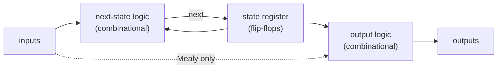
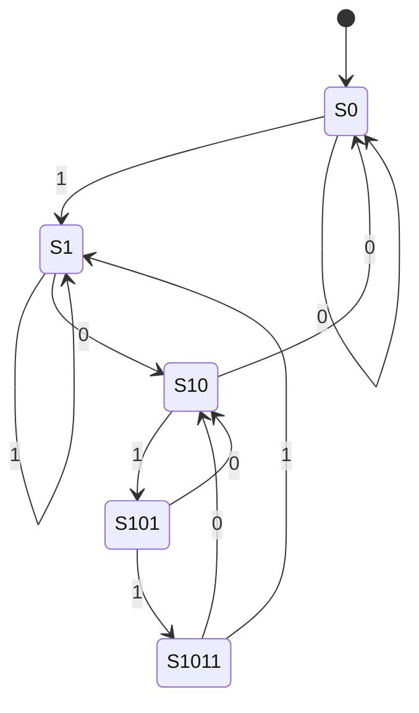
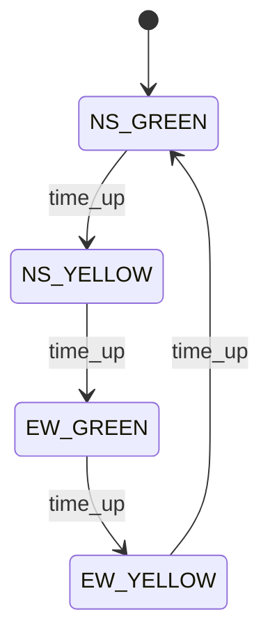
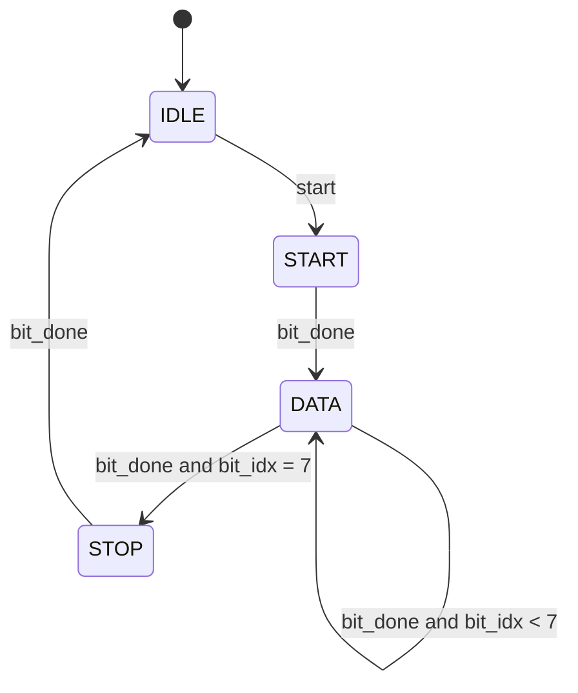

# 06 - Finite state machines

**Reading time:** about 30 minutes.

## Goals

After this chapter you can:

- explain the difference between Moore and Mealy machines and their timing,
- go from a specification to a state diagram to Verilog in fixed steps,
- write FSMs in the three-block, two-block and one-block styles,
- choose a state encoding and make the FSM recover from illegal states,
- combine an FSM with counters (an FSM plus datapath).

## 1. What a state machine is

A **finite state machine** (FSM) is sequential logic with a small number of
named states. At each clock edge it moves to a next state, chosen by the
current state and the inputs. FSMs are the standard way to describe
**control**: protocols, sequencers, controllers.

Every FSM has three parts:



## 2. Moore and Mealy

| | Moore | Mealy |
|---|---|---|
| Outputs depend on | the state only | the state **and** the inputs |
| Output timing | one cycle after the input that caused it | in the same cycle |
| Number of states | often one more | often one less |
| Glitches on outputs | no (if decoded cleanly) | possible: inputs pass straight through |

Example: detect the pattern `1011` on a serial input.

Files: [`examples/06-fsm/sequence-detector/`](../examples/06-fsm/sequence-detector/)

```text
clk edge      1  2  3  4  5  6  7  8
din           1  0  1  1  0  1  1  0
mealy found   0  0  0  1  0  0  1  0   same cycle as the last 1
moore found   0  0  0  0  1  0  0  1   one cycle later
```

The Mealy machine sees the last `1` on its input and reacts immediately.
The Moore machine first has to **enter** a state that means "found".

## 3. From specification to code, in five steps

1. **List inputs and outputs**, and what each output means.
2. **Draw the state diagram.** One state for each situation the machine must
   remember. Label every arrow with its condition.
3. **Check the diagram.** Does every state have an exit for every input
   combination? What is the reset state?
4. **Write the code** in one of the styles below.
5. **Test it** with directed cases (from the diagram) and random input.

For the `1011` detector, the Moore diagram is:



The state names say how much of the pattern has been seen. The arrows out
of `S1011` handle **overlap**: after `1011`, the last `1` may be the start
of the next pattern.

## 4. The three-block style

This is the clearest style, and the one we recommend for learning:

```verilog
localparam S0 = 3'd0, S1 = 3'd1, S10 = 3'd2, S101 = 3'd3, S1011 = 3'd4;

reg [2:0] state, next;

// Block 1: state register (the only clocked block)
always @(posedge clk) begin
  if (rst) state <= S0;
  else     state <= next;
end

// Block 2: next-state logic
always @(*) begin
  next = S0;                        // default
  case (state)
    S0:    next = din ? S1    : S0;
    S1:    next = din ? S1    : S10;
    S10:   next = din ? S101  : S0;
    S101:  next = din ? S1011 : S10;
    S1011: next = din ? S1    : S10;
    default: next = S0;             // illegal codes go home
  endcase
end

// Block 3: output logic (Moore: state only)
assign found = (state == S1011);
```

For the Mealy version, block 3 uses the input too:

```verilog
assign found = (state == S101) && din;
```

Notes:

- `localparam` gives the states names. Never write bare numbers like
  `state == 3'd4` in the logic.
- The next-state block is combinational, so the rules of chapter 04 apply:
  `=`, a default at the top, no latches.
- Only block 1 has a clock. All `<=` are there.

## 5. Other styles

**Two-block style:** next-state logic and output logic share one
combinational block. It is shorter, and common in industry:

```verilog
always @(*) begin
  next  = state;
  found = 1'b0;
  case (state)
    ...
    S1011: begin found = 1'b1; next = din ? S1 : S10; end
  endcase
end
```

**One-block style:** everything in one clocked block. The outputs become
**registers**, so they are clean (no glitches) but they change one cycle
later than in a Moore machine with combinational outputs, unless you
write the output for the **next** state. This style is popular for FSMs with
counters, like the UART below. Be careful with timing when you use it.

All three styles can describe the same hardware. Pick one per project and
use it everywhere.

## 6. Example: a traffic light with a timer

Files: [`examples/06-fsm/traffic-light/`](../examples/06-fsm/traffic-light/)

Real FSMs often wait for a number of cycles. The usual solution is a
counter **next to** the state register:



```verilog
wire time_up = (timer == 3'd0);

always @(posedge clk) begin
  if (rst) begin
    state <= NS_GREEN;
    timer <= GREEN_TIME - 1;
  end else begin
    state <= next;
    if (time_up)  // load the time of the NEXT state
      timer <= (next == NS_GREEN || next == EW_GREEN) ? GREEN_TIME - 1
                                                     : YELLOW_TIME - 1;
    else
      timer <= timer - 3'd1;
  end
end
```

The output block starts with the **safe** value (both roads red) and then
turns on only what the state allows. If the state register is ever
corrupted, the lights fail safe.

The testbench does not copy the FSM. It checks **properties**: one road is
always red, the phases come in the right order, and each phase lasts the
right number of cycles. Property checks are an excellent way to test control logic.

## 7. Example: UART transmitter (FSM plus datapath)

Files: [`examples/06-fsm/uart-tx/`](../examples/06-fsm/uart-tx/)

A UART sends a byte as a frame: a start bit (0), 8 data bits (LSB first)
and a stop bit (1). The line is 1 when idle.

```text
tx:  1 1 | 0 | 1 0 1 0 1 0 1 0 | 1 | 1 1      (8'h55)
     idle start  d0 ........ d7  stop idle
```



The FSM has only four states. The counting is done by a **datapath**:
`clk_cnt` counts clock cycles inside a bit, `bit_idx` counts the bits, and
`shreg` shifts the data out. The FSM controls the datapath. This split,
"FSM for control, counters and registers for data", appears in almost every
real controller.

The `tx` output is a register (one-block style), because a serial line must
never glitch. The testbench contains a small **receiver model** that only
looks at `tx`, samples each bit in its middle and compares the bytes.

## 8. State encoding

How are the states stored as bits?

| Encoding | Example for 4 states | Flip-flops | Notes |
|---|---|---|---|
| Binary | `00, 01, 10, 11` | log2(N) | fewest flip-flops |
| One-hot | `0001, 0010, 0100, 1000` | N | simple, fast next-state logic; common on FPGAs |
| Gray | `00, 01, 11, 10` | log2(N) | one bit changes per step, for sequential FSMs |

Write the states as `localparam`s, and let the synthesis tool re-encode them.
Most FPGA tools detect FSMs and choose the encoding themselves (often one-hot).
Your code stays readable.

### Illegal states

With 3 bits and 5 states, the codes 5, 6 and 7 are unused. A glitch, a
radiation hit or a missing reset could put the FSM into one of them. The
`default` branch of the next-state `case` sends the machine back to a known
state. Always write it.

## 9. Common mistakes

### Mistake 1: no default in the next-state logic

Wrong:

```verilog
always @(*) begin
  case (state)
    IDLE: if (start) next = RUN;
    RUN:  if (done)  next = IDLE;
  endcase
end
```

Why: when `start` is 0 in `IDLE`, `next` is not assigned: a latch.
Fix: begin with `next = state;` (stay by default), and add `default: next = IDLE;`.

### Mistake 2: the state register without a reset

Wrong:

```verilog
always @(posedge clk) state <= next;
```

Why: in simulation, `state` starts as `x`, and `x` stays forever because
every `case` item compares with `x`. In hardware, the start state is random.
Fix: always reset the state register.

### Mistake 3: assigning the state in two blocks

Wrong:

```verilog
always @(posedge clk) if (rst) state <= IDLE;
always @(posedge clk) state <= next;
```

Fix: one clocked block with `if (rst) ... else state <= next;`.

### Mistake 4: a Mealy output used as an input of another Mealy machine

If machine A's Mealy output feeds machine B's Mealy output logic, and B's
output feeds back into A, you have a **combinational loop** through two
modules. It may oscillate, and it is hard to see in the code.
Fix: register one of the outputs (make it Moore, or add a flip-flop).

### Mistake 5: an off-by-one in the timer

Wrong:

```verilog
timer <= GREEN_TIME;    // then count down to 0
```

Why: the state lasts `GREEN_TIME + 1` cycles (from `GREEN_TIME` down to 0).
Fix: load `GREEN_TIME - 1`, and write a testbench that **measures** the
duration, like the traffic light example.

## 10. Exercises

1. [`ex1-vending-machine`](../exercises/06-fsm/ex1-vending-machine/):
   a Moore FSM that sells a 15-cent drink and returns change.
2. [`ex2-mealy-detector`](../exercises/06-fsm/ex2-mealy-detector/):
   a Mealy detector for `101` with overlap.
3. (No solution.) Write a UART **receiver** for the frame format above.
   Reuse the tx example: connect `uart_tx` to your receiver in a testbench
   and check that every byte arrives.

## Summary

- An FSM is a state register, next-state logic and output logic.
- Moore outputs depend on the state, Mealy outputs also on the inputs
  (faster, but may glitch).
- Design in steps: inputs/outputs, diagram, check, code, test.
- Three-block style: one clocked block for the state, combinational blocks
  with defaults for next state and outputs.
- Name states with `localparam`, add a `default` that recovers, and reset
  the state register.
- Big controllers are "FSM plus datapath": the FSM controls counters and registers.

Next: [07 - Parameters, generate, functions and hierarchy](07-parameters-generate-hierarchy.md).
