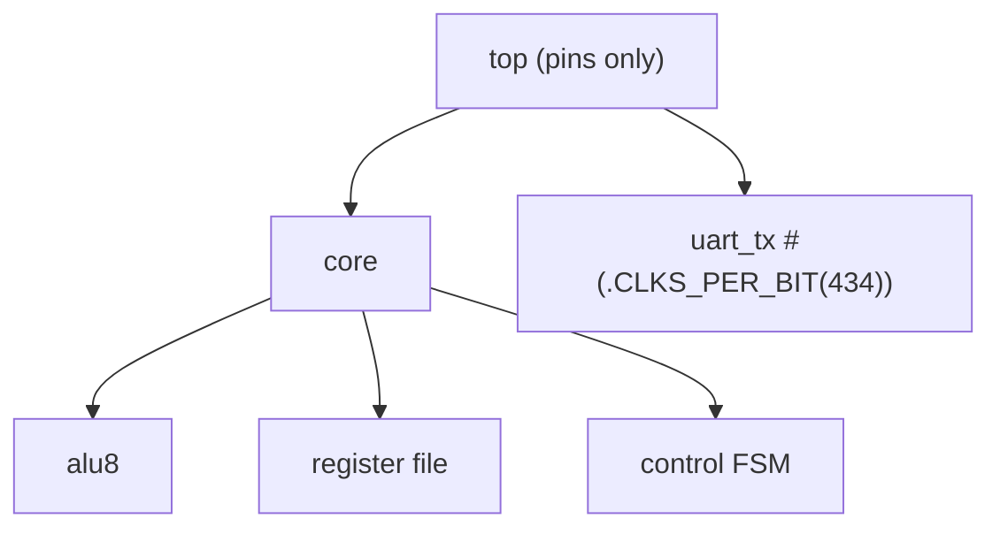

# 07 - Parameters, generate, functions, tasks and hierarchy

**Reading time:** about 30 minutes.

## Goals

After this chapter you can:

- write modules with parameters and override them per instance,
- use `localparam` for derived constants,
- create repeated or optional hardware with `generate for` and `generate if`,
- write functions (also constant functions for widths) and tasks,
- organize a design as a clean hierarchy of reusable modules.

## 1. Parameters

A **parameter** is a constant that can be different for each instance.
It is the Verilog way to write reusable modules.

```verilog
module ripple_adder #(
  parameter WIDTH = 8                   // default value
) (
  input  wire [WIDTH-1:0] a,
  input  wire [WIDTH-1:0] b,
  input  wire             cin,
  output wire [WIDTH-1:0] sum,
  output wire             cout
);
```

Override it when you create an instance, **by name**:

```verilog
ripple_adder #(.WIDTH(4))  add4  (.a(a4),  .b(b4),  ...);
ripple_adder #(.WIDTH(12)) add12 (.a(a12), .b(b12), ...);
```

Parameters are fixed at **elaboration** time, before simulation starts.
They are not signals. You cannot change them while the design runs.

### `localparam`

A `localparam` is a constant that **cannot** be overridden. Use it for
values computed from parameters, and for state names:

```verilog
localparam TOTAL_BITS = WIDTH * DEPTH;
localparam IDLE = 2'd0, RUN = 2'd1;
```

Rule of thumb: `parameter` for what the user may choose, `localparam` for
everything else.

### Avoid `defparam` and positional overrides

```verilog
defparam add4.WIDTH = 4;             // old style: changes a parameter from far away
ripple_adder #(4) add4 (...);        // positional: which parameter is 4?
```

Both work, but they are hard to read and easy to break. Use `#(.NAME(value))`.

## 2. `generate for`: repeated hardware

Files: [`examples/07-parameters-generate-hierarchy/param-adder/`](../examples/07-parameters-generate-hierarchy/param-adder/)

Chapter 01 wrote four `full_adder` lines by hand. With a parameter, the
number of bits is not known when you write the code. A **generate loop**
creates the instances:

```verilog
wire [WIDTH:0] c;
assign c[0] = cin;

genvar i;
generate
  for (i = 0; i < WIDTH; i = i + 1) begin : bit_slice
    full_adder fa (
      .a(a[i]), .b(b[i]), .cin(c[i]), .sum(sum[i]), .cout(c[i+1])
    );
  end
endgenerate

assign cout = c[WIDTH];
```

- A `genvar` is a loop variable that exists only during elaboration.
- Give every generate block a **name** (`bit_slice`). The instances are then
  called `bit_slice[0].fa`, `bit_slice[1].fa`, and so on. You see these
  names in GTKWave and in error messages.
- The loop runs at elaboration time. The result is WIDTH separate full
  adders, exactly as if you had written them by hand.

The difference from a `for` loop inside `always` (chapter 04): a generate
loop can create **instances, wires, `assign` statements and whole `always`
blocks**. A procedural `for` loop can only repeat statements inside one block.

## 3. `generate if`: optional hardware

Files: [`examples/07-parameters-generate-hierarchy/delay-line/`](../examples/07-parameters-generate-hierarchy/delay-line/)

A parameter can also choose between different hardware:

```verilog
generate
  if (DEPTH == 0) begin : no_delay
    assign dout = din;
  end else begin : with_delay
    wire [WIDTH-1:0] stage [0:DEPTH];      // array of wires
    assign stage[0] = din;
    for (k = 1; k <= DEPTH; k = k + 1) begin : reg_stage
      reg [WIDTH-1:0] r;
      always @(posedge clk) r <= stage[k-1];
      assign stage[k] = r;
    end
    assign dout = stage[DEPTH];
  end
endgenerate
```

Notes:

- Only one branch is built. With `DEPTH = 0` there are no registers at all.
- Each loop iteration declares its own `reg r` and its own `always` block.
- `wire [WIDTH-1:0] stage [0:DEPTH]` is an **array of nets**, a
  Verilog-2001 feature. It is handy for chains of stages.
- There is also `generate case`, which works the same way.

### Arrays of instances

Verilog-2001 has a short form for simple repeated instances:

```verilog
full_adder fa [3:0] (.a(a), .b(b), .cin(c[3:0]), .sum(sum), .cout(c[4:1]));
```

Each 4-bit vector is split into one bit per instance. It is compact, but
a generate loop is clearer and more flexible.

## 4. Functions

A **function** computes one value from its inputs, with no delay.
It describes combinational logic.

```verilog
function [W-1:0] bin2gray;
  input [W-1:0] b;
  begin
    bin2gray = b ^ (b >> 1);     // assign the function name to return
  end
endfunction

assign g = bin2gray(count);
```

Rules for functions:

- at least one input, exactly one return value,
- no timing: no `#`, no `@`, no `wait`,
- no non-blocking assignments,
- they may use loops and local variables.

Functions can be declared inside the module that uses them. To share
functions between modules, put them in a file and use `` `include `` inside
each module.

### Constant functions

A function called with constant arguments is evaluated at elaboration time.
It can then set widths:

Files: [`examples/07-parameters-generate-hierarchy/gray-counter/`](../examples/07-parameters-generate-hierarchy/gray-counter/)

```verilog
module gray_counter #(
  parameter MODULO = 16
) (
  ...
  output reg [clog2(MODULO)-1:0] gray     // 4 bits for MODULO = 16
);

  function integer clog2;                 // ceiling of log2
    input integer value;
    integer v;
    begin
      v = value - 1;
      clog2 = 0;
      while (v > 0) begin
        clog2 = clog2 + 1;
        v = v >> 1;
      end
    end
  endfunction
```

Verilog-2005 added the built-in `$clog2`, and Icarus supports it. We show
the function here because it works with any Verilog-2001 tool and shows the
idea of constant functions.

## 5. Tasks

A **task** is like a procedure: it can have several inputs and outputs,
and it **may** contain timing (`#`, `@`). Tasks are mostly used in
testbenches:

```verilog
task send_byte;
  input [7:0] value;
  begin
    @(negedge clk);
    data  = value;
    start = 1'b1;
    @(negedge clk);
    start = 1'b0;
  end
endtask

initial begin
  send_byte(8'h55);
  send_byte(8'hA3);
end
```

| | function | task |
|---|---|---|
| Returns | one value | none (use `output` arguments) |
| Timing (`#`, `@`) | not allowed | allowed |
| Used in | expressions, design and testbench | statements, mostly testbench |

### Static and automatic

By default, functions and tasks are **static**: all calls share the same
local variables. If two `initial` blocks call the same task at the same
time, they overwrite each other's variables. Verilog-2001 adds `automatic`:

```verilog
task automatic wait_cycles;
  input integer n;
  integer i;
  begin
    for (i = 0; i < n; i = i + 1) @(posedge clk);
  end
endtask
```

Use `automatic` for tasks that may run in parallel, and for recursive functions.

## 6. Hierarchy and design organization

Good hierarchy makes a design easy to test and to change:



Guidelines:

- **One module per file**, and the file has the module's name.
  (A few examples in this repository put a buggy and a fixed version in one
  file on purpose.)
- Small modules that do one thing. Each one can have its own testbench.
- Parameters for widths and sizes, so a module can be reused.
- The top module only connects things. It has little logic.
- Hierarchical references (`dut.core.alu.y`) are for **testbenches** only.
  Synthesis tools do not accept them inside a design.

## 7. Common mistakes

### Mistake 1: a positional parameter override

Wrong:

```verilog
module fifo #(parameter WIDTH = 8, parameter DEPTH = 16) (...);
fifo #(32) f (...);          // is 32 the width or the depth?
```

Fix: `fifo #(.WIDTH(32)) f (...);`

### Mistake 2: an unnamed generate block

Wrong:

```verilog
for (i = 0; i < 4; i = i + 1) begin   // no name
  full_adder fa (...);
end
```

Why: the tool invents names like `genblk1[0]`. They change when you edit the
code, and they make debugging hard.
Fix: `begin : bit_slice`.

### Mistake 3: a zero or negative width

Wrong:

```verilog
module counter #(parameter WIDTH = 1) (...);
  reg [WIDTH-2:0] low_bits;   // WIDTH = 1 gives [-1:0]: two bits, not zero!
```

Why: a range like `[-1:0]` is legal and means 2 bits. Parameters at their
edge values often break such expressions.
Fix: test your module with the smallest and largest parameter values. Use
`generate if` for special cases.

### Mistake 4: timing inside a function

Wrong:

```verilog
function [7:0] slow_add;
  input [7:0] a, b;
  begin
    #5 slow_add = a + b;   // not allowed in a function
  end
endfunction
```

Fix: use a task if you need timing (testbench only), or remove the delay.

### Mistake 5: a static task called twice at once

Wrong:

```verilog
task wait_n;              // static: one shared "i" and "n"
  input integer n;
  integer i;
  ...
endtask

initial wait_n(10);
initial wait_n(3);        // overwrites n of the first call
```

Fix: `task automatic wait_n;`.

## 8. Exercises

1. [`ex1-param-mux`](../exercises/07-parameters-generate-hierarchy/ex1-param-mux/):
   an N-to-1 multiplexer with parameters for width and number of inputs.
2. [`ex2-barrel-rotator`](../exercises/07-parameters-generate-hierarchy/ex2-barrel-rotator/):
   a log2(N)-stage barrel rotator built with a generate loop.
3. (No solution.) Rewrite the `counter` of chapter 05 with a `WIDTH`
   parameter, and test it with `WIDTH = 1`, `4` and `16` in one testbench.

## Summary

- `parameter` makes modules reusable. Override by name: `#(.WIDTH(16))`.
- `localparam` is for derived constants and state names.
- `generate for` repeats instances, wires and always blocks. `generate if`
  builds hardware only when a condition on parameters is true. Name every
  generate block.
- Functions: combinational, one result, no timing. Constant functions can
  compute widths.
- Tasks: may wait for time and events. Use them in testbenches. Use
  `automatic` when calls may overlap.
- Build designs as a tree of small modules. One module per file.

Next: [08 - Memories and arrays](08-memories.md).
