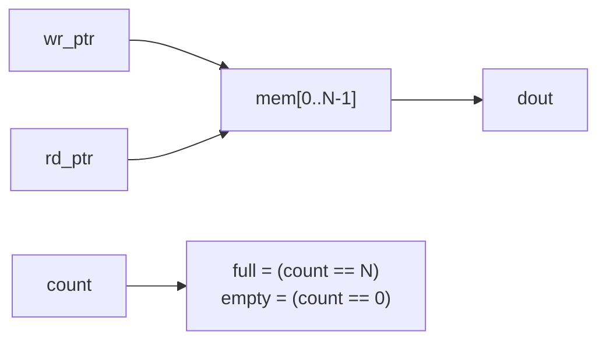

# 08 - Memories and arrays

**Reading time:** about 30 minutes.

## Goals

After this chapter you can:

- declare memories and access words and bits in them,
- load a memory from a file with `$readmemh` and `$readmemb`,
- write ROMs, single-port RAMs and register files that synthesis tools map to real memory,
- explain read-first behaviour and the difference between synchronous and asynchronous read,
- build a FIFO from a memory and two pointers.

## 1. Vectors and arrays

A **vector** is one signal with many bits. A **memory** (array) is many
words, each with its own index:

```verilog
reg [7:0]  byte_value;          // vector: 8 bits
reg [7:0]  mem [0:15];          // memory: 16 words of 8 bits
//  ^^^^^ word width   ^^^^^^ number of words (the address range)
```

Read the declaration from the middle: `mem` is an array of 16 elements
`[0:15]`, and each element is `[7:0]`.

Accessing a memory:

```verilog
mem[3]          // word 3 (8 bits)
mem[addr]       // word at a variable address
mem[3][7]       // bit 7 of word 3        (Verilog-2001)
mem[3][7:4]     // high nibble of word 3  (Verilog-2001)
```

Rules to remember:

- You access **one word at a time**. `mem = 0;` (the whole array) is not
  allowed in Verilog-2001. Use a loop.
- Verilog-2001 also allows arrays of nets (`wire [7:0] w [0:3];`) and
  multidimensional arrays (`reg [7:0] img [0:3][0:3];`).
- Array **ports** are not allowed in Verilog-2001. Pack the words into a flat
  vector instead (see exercise 07.1).

## 2. Loading memories from files

```verilog
initial $readmemh("squares.hex", mem);              // hex digits
initial $readmemb("pattern.bin", mem);              // binary digits
initial $readmemh("data.hex", mem, 4, 7);           // only addresses 4 to 7
```

The file is plain text:

```text
// squares.hex - comments are allowed
@0          // optional: the address of the next value
00
01
04
09
```

- Values are separated by spaces or new lines. Underscores are allowed.
- `@hex_address` jumps to a new address.
- The path is relative to the folder where the **simulator** runs. All
  examples in this repository run inside their own folder.
- FPGA synthesis tools (Vivado, Quartus, Yosys) also read `$readmemh` in an
  `initial` block to set the initial contents of a block RAM or ROM.

## 3. Example: a ROM

Files: [`examples/08-memories/rom-readmemh/`](../examples/08-memories/rom-readmemh/)

```verilog
module rom_squares #(
  parameter INIT_FILE = "squares.hex"
) (
  input  wire       clk,
  input  wire [3:0] addr,
  output reg  [7:0] data
);
  reg [7:0] mem [0:15];

  initial $readmemh(INIT_FILE, mem);

  always @(posedge clk)
    data <= mem[addr];      // synchronous read: data one cycle later
endmodule
```

Passing the file name as a parameter lets each instance use its own contents.

For very small tables, a `case` statement (like the seven-segment decoder in
chapter 04) is also a ROM. Use a file when the table is long, or when another
program (Python, MATLAB) computes it.

## 4. Synchronous and asynchronous read

```verilog
// Synchronous read: the address is registered, data comes one cycle later
always @(posedge clk) dout <= mem[addr];

// Asynchronous read: data follows the address at once (combinational)
assign dout = mem[addr];
```

This choice decides what hardware you get on an FPGA:

| Read style | FPGA resource | Typical size |
|---|---|---|
| synchronous | **block RAM** (dedicated memory blocks) | kilobits and more |
| asynchronous | **distributed RAM** (built from LUTs) or flip-flops | small: register files, small tables |

Block RAMs have a registered read port. If you write an asynchronous read
for a large memory, the tool cannot use block RAM and builds it from
thousands of LUTs or flip-flops, or reports an error.

## 5. Example: a single-port RAM

Files: [`examples/08-memories/single-port-ram/`](../examples/08-memories/single-port-ram/)

```verilog
reg [DATA_W-1:0] mem [0:DEPTH-1];

always @(posedge clk) begin
  if (we)
    mem[addr] <= din;
  dout <= mem[addr];          // the OLD value when we write the same address
end
```

### Read-first, write-first

What does `dout` show when you write and read the same address in one cycle?

- **Read-first** (this code): the old value. The read uses the contents
  before the non-blocking write takes effect.
- **Write-first**: the new value (`dout <= we ? din : mem[addr];`).
- **No-change**: `dout` keeps its value during a write.

```text
clk edge     1          2
addr         5          5
we           1          0
din          AA         -
dout (after) old mem[5] AA
```

FPGA block RAMs support all three modes. The code style tells the tool which
one you want. Write the mode in a comment, because it matters for anyone who
uses the RAM.

### Dual-port RAMs

A **simple dual-port** RAM has one write port and one independent read port:

```verilog
always @(posedge clk) begin
  if (we) mem[waddr] <= din;
  dout <= mem[raddr];
end
```

This is the most common memory in FPGA designs (FIFOs, line buffers).

## 6. Example: a register file

Files: [`examples/08-memories/register-file/`](../examples/08-memories/register-file/)

A processor register file needs two reads and one write per cycle, and the
reads must be fast. A small array with **asynchronous** read is the usual answer:

```verilog
reg [7:0] regs [0:7];

always @(posedge clk)
  if (we && waddr != 3'd0) regs[waddr] <= wdata;     // r0 cannot be written

assign rdata_a = (raddr_a == 3'd0) ? 8'd0 : regs[raddr_a];
assign rdata_b = (raddr_b == 3'd0) ? 8'd0 : regs[raddr_b];
```

The `initial` loop that sets every register to 0 is **simulation only**
(on some FPGAs it also sets the power-up value). Chapter 10 discusses
initial values.

## 7. Building a FIFO

A FIFO is a memory used as a circular buffer, with a **write pointer**, a
**read pointer** and a **count**:



```verilog
wire do_write = wr_en && !full;
wire do_read  = rd_en && !empty;

always @(posedge clk) begin
  if (do_write) begin mem[wr_ptr] <= din;  wr_ptr <= wr_ptr + 1; end
  if (do_read)  begin dout <= mem[rd_ptr]; rd_ptr <= rd_ptr + 1; end
  count <= count + do_write - do_read;
end
```

With 3-bit pointers and 8 entries, `7 + 1` wraps to `0` by itself.
Exercise 08.2 asks you to complete it, with a testbench that has a queue model.

## 8. Memories in waveforms

`$dumpvars` in Icarus does not write memory arrays to the VCD file. To watch
a word, make a wire in the testbench:

```verilog
wire [7:0] word5 = dut.mem[5];
```

Or print it: `$display("mem[5] = %h", dut.mem[5]);`.

## 9. Common mistakes

### Mistake 1: the file is not found

```text
WARNING: rom_squares.v:24: $readmemh(squares.hex): Unable to open squares.hex for reading.
```

The simulation continues, and every word is `x`. This is a warning, not an
error, so it is easy to miss.
Fix: run the simulator in the folder of the file, or give a path. A testbench
can check `dut.mem[0] !== 8'bx` at time 1, like the ROM example.

### Mistake 2: resetting a whole memory

Wrong:

```verilog
always @(posedge clk) begin
  if (rst)
    for (i = 0; i < 1024; i = i + 1) mem[i] <= 0;   // 1024 writes in one cycle
  else if (we)
    mem[addr] <= din;
end
```

Why: a block RAM can write one word per cycle. Synthesis must build the
memory from 1024 x N flip-flops instead.
Fix: do not reset memory contents. Reset the **control** logic (pointers,
valid bits) instead, and use `$readmemh` for initial values if needed.

### Mistake 3: asynchronous read of a large memory

Wrong:

```verilog
reg [31:0] big [0:4095];
assign dout = big[addr];
```

Fix: register the read (`always @(posedge clk) dout <= big[addr];`) and
plan for one cycle of latency.

### Mistake 4: an address that is too wide or too narrow

Wrong:

```verilog
reg [7:0] mem [0:15];
wire [3:0] addr;
... mem[addr + 1] ...    // addr = 15: addr + 1 = 16 (5-bit context): out of range
```

Why: the index expression is not cut to 4 bits. Reading outside the array
gives `x` in simulation. Writing outside is ignored.
Fix: be explicit about wrap-around: `wire [3:0] next_addr = addr + 4'd1;`

### Mistake 5: writing a memory from two blocks

Wrong:

```verilog
always @(posedge clk) if (we_a) mem[addr_a] <= din_a;
always @(posedge clk) if (we_b) mem[addr_b] <= din_b;
```

This is a true dual-port memory. Some FPGA block RAMs support it, but the
code must follow the vendor's template exactly, and a write to the same
address from both ports is undefined. For simple designs, use one write port.

## 10. Exercises

1. [`ex1-byte-enable-ram`](../exercises/08-memories/ex1-byte-enable-ram/):
   a 32-bit RAM with four byte-write enables.
2. [`ex2-sync-fifo`](../exercises/08-memories/ex2-sync-fifo/):
   an 8-entry synchronous FIFO with full, empty and count.
3. (No solution.) Make the ROM example 256 words deep. Generate the hex file
   with a small Python script (for example a sine table), and check some
   values in the testbench.

## Summary

- `reg [W-1:0] mem [0:D-1];` declares D words of W bits. Access one word at a time.
- `$readmemh` / `$readmemb` load memories from text files, in simulation and synthesis.
- Synchronous read maps to block RAM. Asynchronous read is for small memories.
- Know your read-during-write mode: read-first, write-first or no-change.
- Do not reset memory contents. Reset the control logic.
- A FIFO is a memory, two pointers and a count.

Next: [09 - Testbenches](09-testbenches.md).
