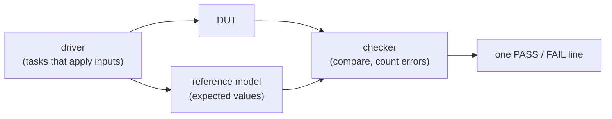

# 09 - Testbenches

**Reading time:** about 30 minutes.

## Goals

After this chapter you can:

- structure a testbench as clock, drivers, reference model and checkers,
- drive a design without races and check it at the right moment,
- use `$display`, `$strobe`, `$monitor`, `%t` and waveform dumps well,
- end a simulation with a clear PASS or FAIL and a correct exit status,
- read test vectors from files and write result files,
- use seeded random stimulus with coverage counters,
- test your testbench.

## 1. What a testbench is

A testbench is a Verilog module **without ports**. It is not hardware: it may
use delays, files, loops over time, `real` numbers and everything else the
simulator offers. Its job is to answer one question: **does the design do
what the specification says?**

A good testbench has four parts:



For small designs all four live in one file. The
[toolkit example](../examples/09-testbenches/tb-toolkit/) is a template you
can copy.

## 2. Clock and reset

```verilog
localparam CLK_PERIOD = 10;

initial begin
  clk = 1'b0;
  forever #(CLK_PERIOD / 2) clk = ~clk;
end

task reset_dut;
  input integer n;
  begin
    rst = 1'b1;
    repeat (n) @(negedge clk);
    rst = 1'b0;
  end
endtask
```

Always initialize the clock (`clk = 1'b0`). If you only write
`always #5 clk = ~clk;`, the clock starts as `x`, and `~x` is `x` forever.

### Time units

`` `timescale 1ns/1ps `` means: `#1` is 1 ns, and times are rounded to 1 ps.
Put the same `` `timescale `` in every file. If some files have one and others
do not, Icarus warns, and delays may mean different things in different files.

## 3. Driving inputs without races

The safe rule from chapter 05: **change inputs at the falling edge**, so they
are stable at the rising edge where the DUT samples them.

```verilog
task send;
  input [7:0] value;
  begin
    valid = 1'b1;
    din   = value;
    @(negedge clk);       // one full cycle with valid = 1
    valid = 1'b0;
    din   = 8'hxx;        // x when not valid: finds DUTs that use stale data
  end
endtask
```

Setting data to `x` when it is not valid is a cheap but powerful trick: if the
DUT uses the data at the wrong time, `x` appears in its outputs and the
checker sees it.

For **combinational** DUTs, wait a little after changing inputs before you check:

```verilog
a = 8'd5; b = 8'd3;
#1;                       // let the assign statements update
if (y !== 8'd2) ...
```

Without the `#1`, the check runs in the same time step as the change, and it
may see the old output.

## 4. Checking

### Compare with `!==`

```verilog
if (sum !== expected) begin
  $display("ERROR at %t: sum = %0d, expected %0d", $time, sum, expected);
  errors = errors + 1;
end
```

`!==` also catches `x` and `z`. Print the inputs, the output and the
expected value: a good error message saves a lot of waveform reading.

### Where does the expected value come from?

| Method | When to use | Example in this repository |
|---|---|---|
| **Reference model** written in a different style | most data-path blocks | ALU (chapter 03): integers instead of `>>>` |
| **Properties** | when the "right answer" is easy to check but hard to compute | sorter: output is ordered and a permutation |
| **Vectors from a file** | when a script in another language is the model | file I/O example below |
| **Cycle model** in the testbench | sequential blocks | counter, FIFO: a model updated at the same clock edge |

Never copy the design code into the model. A copied bug passes every test.

### When to check sequential outputs

Check registered outputs either

- at the **falling** edge (half a period after they changed), or
- at the **rising** edge, before the non-blocking updates: at that moment the
  outputs still show the values of the cycle that just ended.

Both are race-free. Both are used in this repository.

## 5. Printing

```verilog
$display("x = %0d", x);      // prints now, with a newline
$write("no newline ");        // like $display, without the newline
$strobe("x = %0d", x);       // prints at the END of this time step
$monitor("%t a=%b y=%b", $time, a, y);   // prints whenever an argument changes
$monitoroff;  $monitoron;     // pause and restart $monitor
```

`$display` versus `$strobe` at a clock edge:

```text
at the edge, $display sees the OLD sum: 60
at the edge, $strobe  sees the NEW sum: 61
```

`$display` runs immediately, before the non-blocking assignments of this
time step. `$strobe` waits until they are done.

### Printing time

`%t` prints a time value. `$timeformat` sets how:

```verilog
$timeformat(-9, 1, " ns", 10);   // unit 10^-9 (ns), 1 decimal, suffix, min. width
$display("%t", $time);           // "    25.0 ns"
```

Without `$timeformat`, `%t` prints in the simulation precision (ps here), so
`25 ns` appears as `25000`. That surprises everybody once.

## 6. Waveforms

```verilog
initial begin
  $dumpfile("tb_name.vcd");
  $dumpvars(0, tb_name);     // 0 = all levels below tb_name
end
```

- `$dumpvars(1, tb_name)` records only the top level. `$dumpvars(0, dut.alu)`
  records only one sub-block.
- `$dumpoff` and `$dumpon` pause and restart recording. Long tests produce
  huge files: record only the start, or only the window around a bug.
- Icarus does not dump memory arrays. Add a wire for the word you want to see.

## 7. Ending the simulation

| Task | Effect |
|---|---|
| `$finish;` | ends the simulation (exit status 0) |
| `$stop;` | pauses and opens the interactive prompt (`vvp -n` turns it into `$finish`) |
| `$fatal(1, "msg");` | prints the message and ends with exit status 1 |

`$fatal` comes from SystemVerilog, but Icarus accepts it in Verilog-2001 mode.
The non-zero exit status lets `make`, scripts and CI detect the failure.

### The watchdog

A test that waits for a signal that never comes runs forever. A second
`initial` block ends it:

```verilog
initial begin
  #(TIMEOUT);
  $display("FAIL: tb_accumulator (timeout after %0d ns)", TIMEOUT);
  $fatal(1, "timeout");
end
```

For handshakes, also count cycles inside the wait loop, like the GCD solution:

```verilog
cycles = 0;
while (done !== 1'b1 && cycles < MAX_CYCLES) begin
  @(negedge clk);
  cycles = cycles + 1;
end
```

## 8. File input and output

Files: [`examples/09-testbenches/file-io/`](../examples/09-testbenches/file-io/)

```verilog
fin = $fopen("vectors.txt", "r");           // 0 if the file is missing
if (fin == 0) $fatal(1, "cannot open vectors.txt");
fout = $fopen("results_out.txt", "w");

while (!$feof(fin)) begin
  got = $fgets(line, fin);                   // one line into a reg vector
  n   = $sscanf(line, "%h %h %h", va, vb, vexp);
  if (got > 0 && n == 3) begin               // skip comments and empty lines
    a = va; b = vb; #1;
    if (y !== vexp) ...
    $fdisplay(fout, "%h %h %h %h", a, b, vexp, y);
  end
end
$fclose(fin);
$fclose(fout);
```

All these tasks are part of Verilog-2001. `$fscanf(fin, ...)` reads directly
from the file. `$fgets` plus `$sscanf` makes it easy to skip comment lines.

## 9. Random stimulus

Files: [`examples/09-testbenches/random-stimulus/`](../examples/09-testbenches/random-stimulus/)

```verilog
integer seed;
initial begin
  seed = 1;
  if ($value$plusargs("seed=%d", seed))     // vvp sim.vvp +seed=42
    $display("seed = %0d", seed);
  ...
  a = $random(seed);                          // a new value, and seed changes
end
```

- `$random` returns a **signed** 32-bit value. `$random % 10` can be
  negative. Use `$random & 7` or `$unsigned($random) % 10` for ranges.
- With the same seed, the sequence is always the same. Print the seed, so a
  failure can be reproduced.
- `$dist_uniform(seed, low, high)` gives a value in a range.

### Constrained random and coverage

Pure random 8-bit values almost never hit corner cases (0, 255, equal
values). Bias the stimulus:

```verilog
function [7:0] pick;
  input integer mode;
  case (mode)
    0: pick = $random(seed) & 3;                // small
    1: pick = 8'd252 + ($random(seed) & 3);     // near the top
    2: pick = 8'd0;
    3: pick = 8'd255;
    default: pick = $random(seed);              // anything
  endcase
endfunction
```

Then **count** what was tested, and fail if an important case never happened:

```verilog
if (a == b || b == c || a == c) cov_two_equal = cov_two_equal + 1;
...
if (cov_two_equal == 0) begin
  $display("ERROR: equal values were never tested");
  errors = errors + 1;
end
```

This is a small version of **functional coverage**, which SystemVerilog
supports directly (see the appendix).

## 10. Testing the testbench

A testbench that always passes is worse than none, because it gives false
confidence. Two habits:

1. **Break the DUT on purpose** and check that the testbench fails.
   (Exercise 09.1 asks you to do this.)
2. In this repository, the CI runs every exercise testbench against the
   unfinished stub and **requires a FAIL** (`make stubs`). This proves that the
   testbenches really check something.

## 11. Common mistakes

### Mistake 1: no clock initialization

Wrong:

```verilog
reg clk;
always #5 clk = ~clk;      // clk is x forever
```

Fix: `initial clk = 1'b0;` (or the `forever` form).

### Mistake 2: driving and sampling at the same edge

Wrong:

```verilog
@(posedge clk);
din = 8'd5;                // changes at the edge where the DUT samples
```

Why: whether the DUT sees 5 or the old value depends on which block the
simulator runs first. Chapter 11 shows this race.
Fix: `@(negedge clk); din = 8'd5;` or use `din <= 8'd5;` after `@(posedge clk)`.

### Mistake 3: checking a combinational output with no delay

Wrong:

```verilog
a = 8'd5;
if (y !== 8'd10) ...       // y has not been updated yet
```

Fix: add `#1;` between the change and the check.

### Mistake 4: a model that copies the design

Wrong:

```verilog
expected = (a >= b) ? a - b : b - a;   // the same expression as the DUT
```

Why: a misunderstanding in the design is copied into the check.
Fix: use a different method (integers, a loop, a property, a file).

### Mistake 5: no PASS/FAIL decision

Wrong:

```verilog
initial begin
  ...
  $display("y = %h", y);   // a human must read it
  $finish;
end
```

Fix: count errors and print one clear result line. End with `$fatal` on failure.

## 12. Exercises

1. [`ex1-test-the-gcd`](../exercises/09-testbenches/ex1-test-the-gcd/):
   write the complete testbench for a multi-cycle GCD unit with a handshake.
2. [`ex2-file-driven-test`](../exercises/09-testbenches/ex2-file-driven-test/):
   test a binary-to-BCD converter with 256 vectors from a file.
3. (No solution.) Add a `+verbose` plusarg to the toolkit testbench that turns
   the `$monitor` on or off.

## Summary

- Testbench = clock and reset, drivers (tasks), reference model, checkers, one result line.
- Change inputs at the falling edge. Wait `#1` before checking combinational outputs.
- Compare with `!==`. Write the model in a different style from the design.
- `$strobe` sees values after the non-blocking updates. Use `$timeformat` with `%t`.
- Add a watchdog. End with `$finish` or `$fatal(1, ...)`.
- Files and seeded random stimulus extend your tests. Count coverage.
- Make sure your testbench can fail.

Next: [10 - Synthesizable versus simulation-only code](10-synthesizable-vs-simulation.md).
