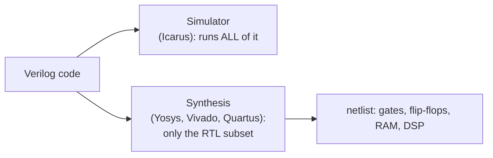

# 10 - Synthesizable versus simulation-only code

**Reading time:** about 30 minutes.

## Goals

After this chapter you can:

- say which Verilog constructs become hardware and which are for simulation only,
- write RTL that synthesizes to what you expect,
- explain why simulation and hardware can disagree, and avoid the common causes,
- understand x-optimism and initial values,
- use a behavioural model as a reference for RTL.

## 1. Two uses of one language

Verilog was designed for **simulation**. Later, synthesis tools learned to
turn a **subset** of it into gates and flip-flops. That subset is called
**synthesizable RTL** (register-transfer level).



A testbench may use everything. A design that should become hardware must
stay inside the subset. When you write design code, always ask: **what
hardware does this describe?** If you cannot draw it, the tool cannot build it.

## 2. What synthesis accepts

| Construct | Synthesizable? | Notes |
|---|---|---|
| `assign`, `always @(*)` | yes | combinational logic |
| `always @(posedge clk ...)` | yes | flip-flops |
| `if`, `case`, `casez`, `? :` | yes | multiplexers and decoders |
| `for` with constant bounds | yes | unrolled |
| `+ - * & \| ^ << >>` | yes | `*` may use DSP blocks |
| `/ %` | only by constants (best: powers of two) | |
| `parameter`, `localparam`, `generate` | yes | elaboration time |
| `function` | yes | combinational |
| `task` without timing | usually | |
| memories `reg [7:0] m [0:N]` | yes | RAM or registers |
| `initial` | **only** for memory / register initial values on FPGAs | ignored on ASICs |
| `#` delays | **ignored** (some tools warn) | |
| `forever`, `wait`, `repeat` with events | no | |
| several `@` in one block | no | |
| `$display`, `$finish`, `$random`, files | no | ignored or errors |
| `real`, `time` | no | |
| `===`, `!==`, `x` and `z` comparisons | no | `x` in assignments = "don't care" |
| `force`, `release`, `fork/join` | no | |

## 3. Example: behavioural model versus RTL

Files: [`examples/10-synthesizable-vs-simulation/model-vs-rtl/`](../examples/10-synthesizable-vs-simulation/model-vs-rtl/)

Both modules give one pulse every 8 clock cycles.

The behavioural model reads like a description in words:

```verilog
initial begin
  pulse = 1'b0;
  @(negedge rst);
  @(posedge clk);
  forever begin
    repeat (PERIOD - 1) @(posedge clk);
    #1 pulse = 1'b1;
    @(posedge clk);
    #1 pulse = 1'b0;
  end
end
```

It waits for events inside a loop and uses delays. There is no hardware that
"waits inside a loop". The RTL version expresses the same thing as **state**
(a counter) and a rule for the next state:

```verilog
always @(posedge clk) begin
  if (rst) begin
    cnt <= 8'd0;  pulse <= 1'b0;
  end else if (cnt == PERIOD - 1) begin
    cnt <= 8'd0;  pulse <= 1'b1;
  end else begin
    cnt <= cnt + 8'd1;  pulse <= 1'b0;
  end
end
```

The testbench runs both and compares them every cycle. Behavioural models
are useful: as a quick **reference** for your RTL, and as models of things
outside your chip (sensors, memories, a PC on the other end of a UART).

## 4. Delays are ignored

```verilog
assign #5 y = a & b;   // simulation: y changes 5 ns after a or b
                       // synthesis:  an AND gate. The 5 ns is ignored.
```

Real delays come from the gates and wires that the tool chooses, not from
your code. Do not use `#` in RTL to "fix" timing. If the design works in
simulation only because of a `#`, it will fail in hardware. Chapter 11 shows
how delays behave in simulation.

## 5. Initial values and resets

```verilog
reg [7:0] count = 8'd0;          // same as: initial count = 8'd0;
```

- **Simulation:** the register starts at 0.
- **FPGA:** most FPGA tools use it as the power-up value of the flip-flop.
  But it is applied **once**, at configuration. Pressing reset later does not
  restore it, unless your code has a reset.
- **ASIC:** ignored. The flip-flop powers up with a random value.

So the rule is: **use a reset for every register whose start value matters**
(state machines, counters, valid flags). Data registers that are always
written before they are read (a pipeline data path) often need no reset,
which saves resources.

Exercise 10.2 shows a counter that "works" with `initial` and fails as soon
as the register starts with a random value.

## 6. x in simulation, don't care in synthesis

Assigning `x` in RTL means "I do not care what this value is":

```verilog
case (sel)
  2'd0: y = a;
  2'd1: y = b;
  2'd2: y = c;
  default: y = 8'bx;   // sel = 3 never happens: let the tool optimize
endcase
```

- **Synthesis** chooses whatever value makes the logic smallest.
- **Simulation** shows `x` if `sel` is ever 3, which helps you find the bug.

That is a good use of `x`. Comparing with `x` (`if (a == 1'bx)`) is not
synthesizable and is always false in hardware.

### x-optimism

Files: [`examples/10-synthesizable-vs-simulation/x-optimism/`](../examples/10-synthesizable-vs-simulation/x-optimism/)

What happens when a select signal is `x` in simulation, for example because
its register was never reset? With `a = 1111_0000` and `b = 1111_1111`:

| Style | Simulation result |
|---|---|
| `if (sel) y = a; else y = b;` | `1111_1111`: the x is **hidden** |
| `assign y = sel ? a : b;` | `1111_xxxx`: equal bits kept, others x |
| `case` with `default: y = 8'bx;` | `xxxx_xxxx`: the x stays visible |

The hardware is the same for all three. Real hardware with an undefined
select gives **some** value, maybe a, maybe b, maybe a mix. The `if` version
is **optimistic**: it pretends to know. A test can pass in simulation while
the chip fails. Defenses:

- reset all control registers,
- check outputs for x in the testbench: `if (^y === 1'bx) ...`
  (the XOR reduction of a vector is x if any bit is x or z),
- use `? :` or a `case` with an x default for important selects.

## 7. Simulation/synthesis mismatches: the usual suspects

| Cause | Chapter |
|---|---|
| incomplete sensitivity list `always @(a or b)` | 04 |
| latch from a missing `else` or `default` | 04 |
| blocking `=` in clocked blocks, races between blocks | 05, 11 |
| `#` delays that the design depends on | 10, 11 |
| `initial` instead of reset | 10 |
| x-optimism of `if` and `case` without default | 10 |
| `casex` / `casez` matching x or z in simulation | 04 |
| signals assigned in more than one block | 04 |

Lint tools find many of these automatically. Run `make lint`
(Verilator and Yosys) on your designs. Verilator reports, for example:

```text
%Warning-LATCH: ... Latch inferred for signal 'latch_bad.q' (not all control paths of combinational always assign a value)
%Warning-BLKSEQ: ... Blocking assignment '=' in sequential logic process
```

## 8. Guidelines for RTL

1. Only two kinds of blocks: `always @(*)` with `=`, and
   `always @(posedge clk)` with `<=`.
2. One clock for the whole design if you can. No logic on clock signals.
3. Reset control registers. Do not rely on `initial`.
4. No `#` delays, no `$display` in design files (or put them in
   `` `ifdef SIMULATION `` blocks).
5. Assign every variable in one block only.
6. Keep design files and testbench files separate.

## 9. Common mistakes

### Mistake 1: a delay that the design depends on

Wrong:

```verilog
always @(posedge clk) begin
  data_out <= #2 data_in;    // "so the output changes after the clock"
end
```

Why: in simulation the delay hides a race. In hardware it does not exist.
Fix: remove the delay and fix the real problem (usually a testbench that
samples at the same edge, see chapter 11).

### Mistake 2: a testbench-style loop in the design

Wrong:

```verilog
always begin
  wait (start);
  repeat (8) @(posedge clk) shift_out;
end
```

Fix: describe it as a state machine with a counter (chapter 06).

### Mistake 3: `initial` as reset

Wrong:

```verilog
reg [3:0] state = IDLE;
always @(posedge clk) state <= next;
```

Fix:

```verilog
always @(posedge clk)
  if (rst) state <= IDLE;
  else     state <= next;
```

### Mistake 4: `$display` in a design module

It does no harm in synthesis (it is ignored), but it is noise. Put debug
prints in the testbench, or guard them:

```verilog
`ifdef SIMULATION
  always @(posedge clk) if (error) $display("error flag at %t", $time);
`endif
```

Run with `iverilog -DSIMULATION ...` to enable them.

## 10. Exercises

1. [`ex1-make-it-synthesizable`](../exercises/10-synthesizable-vs-simulation/ex1-make-it-synthesizable/):
   rewrite a behavioural LED blinker as RTL.
2. [`ex2-reset-not-initial`](../exercises/10-synthesizable-vs-simulation/ex2-reset-not-initial/):
   replace an `initial` value with a real reset.
3. (No solution.) Run `make lint` and read the Verilator warnings for
   `examples/04-combinational-logic/pitfalls`. Match each warning with a bug
   from chapter 04.

## Summary

- Simulators run all of Verilog. Synthesis accepts only the RTL subset.
- Delays, `forever`, waits inside loops, file and print tasks are simulation only.
- `initial` values are a power-up value on FPGAs and nothing on ASICs: use resets.
- `x` in an assignment means "don't care" for synthesis and "unknown" for simulation.
- `if` hides an x select (x-optimism). Reset control registers and check for x.
- Behavioural models are good references for RTL.

Next: [11 - Race conditions and timing pitfalls](11-races-and-timing.md).
