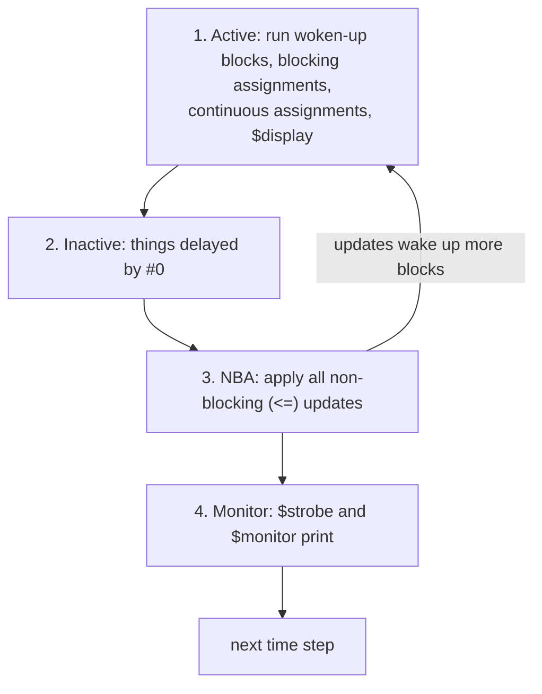
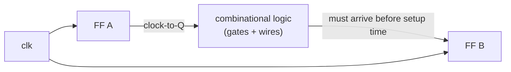

# 11 - Race conditions and timing pitfalls

**Reading time:** about 30 minutes.

## Goals

After this chapter you can:

- describe, in simple terms, how a Verilog simulator orders events in one time step,
- recognize race conditions in designs and testbenches, and remove them,
- explain inertial and transport delays, and why RTL should not depend on them,
- connect simulation time to real hardware timing: setup, hold and the critical path.

## 1. How a simulator runs one time step

A simulator jumps from one time to the next. At each time step it has a list
of things to do. A simplified picture of the order is:



Two facts follow from this picture:

1. Inside the **active** region, the order in which blocks run is **not
   defined** by the standard. If two blocks wake up at the same clock edge,
   the simulator may run either one first.
2. **Non-blocking** updates happen only after **all** active work is done.
   So every block that reads a register at a clock edge sees its **old** value,
   no matter which block runs first.

That is the whole reason why `<=` makes clocked logic safe.

## 2. What is a race?

A **race** is a situation where the result depends on the order of
events in the same time step. The code may work in one simulator and fail
in another, or fail after a small, unrelated change.

### Race 1: blocking assignments in clocked blocks

Files: [`examples/11-races-and-timing/swap-race/`](../examples/11-races-and-timing/swap-race/)

```verilog
always @(posedge clk) a = b;    // block 1
always @(posedge clk) b = a;    // block 2
```

If block 1 runs first, `a` gets `b`, and then block 2 copies the **new** `a`
back into `b`: both now hold the old `b`. In the other order, both hold the
old `a`. Either way, the swap fails.

```verilog
always @(posedge clk) a <= b;   // both read old values
always @(posedge clk) b <= a;   // then both update: a real swap
```

### Race 2: the testbench drives at the sampling edge

```verilog
// testbench
always @(posedge clk) din = $random;     // changes din at the edge ...

// design
always @(posedge clk) q <= din;          // ... where the design samples it
```

Does `q` get the old or the new `din`? It depends on which block runs first.
Fixes, each one race-free:

```verilog
@(negedge clk) din = $random;            // 1. drive at the other edge
@(posedge clk) din <= $random;           // 2. drive with <= at the same edge
@(posedge clk) #1 din = $random;         // 3. drive a little after the edge
```

This repository uses fix 1 everywhere: inputs change at the falling edge.

### Race 3: two initial blocks at time 0

```verilog
initial rst = 1'b1;
initial if (rst) $display("in reset");   // may run before rst is set!
```

Fix: do the work in one `initial` block, or wait a little (`#1`) before
reading values that another block sets at time 0.

### Race 4: a clock made with a blocking assignment

```verilog
always @(*) clk_copy = clk;     // a "copy" of the clock, one step later

always @(posedge clk)      a <= din;
always @(posedge clk_copy) b <= a;   // may see the NEW a: a shifted clock edge
```

The second clock edge happens in a later step of the same time, **after**
the non-blocking update of `a` may have happened. Fix: never pass clocks
through logic or assignments in RTL. Use one clock and enables (chapter 05).

## 3. Exercise preview: a race that depends on file order

In exercise 11.1, three blocking pipeline stages are in three separate
blocks. Icarus runs them in the order of the source file, so the pipeline
collapses. If you reverse the order of the blocks, it "works" in Icarus, but
nothing in the language guarantees this. The only real fix is `<=`.

## 4. Delays in simulation

Simulation delays describe **time**, which real hardware has, but your RTL
should not rely on. There are three kinds of delay you will meet:

Files: [`examples/11-races-and-timing/delay-types/`](../examples/11-races-and-timing/delay-types/)

| Style | Code | A 2 ns pulse through a 5 ns delay |
|---|---|---|
| inertial | `assign #5 y = a;` | swallowed, like a slow gate |
| transport | `always @(a) y <= #5 a;` | passes, 5 ns later, like a long wire |
| sleeping block | `always @(a) #5 y = a;` | missed: the block sleeps 5 ns, then samples |

```text
time (ns)    20 22        42        52
a            _/~\_________/~~~~~~~~~\________
y_inertial   ____________________/~~~~~~~~~\___
y_transport  ______/~\________________/~~~~~~~~~\__
```

### Delay before or inside the assignment

```verilog
#5 y = a;       // wait 5, THEN read a and assign (inter-assignment delay)
y = #5 a;       // read a NOW, assign it 5 later (intra-assignment delay),
                // and the block is blocked during the 5 ns
y <= #5 a;      // read a now, schedule the update 5 later, continue at once
```

In testbenches, `#` delays are normal and useful. In RTL, they are ignored
by synthesis. A design that only works because of a delay is a broken design.

## 5. Timing in real hardware

In the simulator, a flip-flop output changes exactly at the clock edge, and
gates take no time. Real hardware is different:



- **Clock-to-Q:** the time after the edge until a flip-flop output changes.
- **Propagation delay:** the time through the combinational logic.
- **Setup time:** the data must be stable this long **before** the next edge.
- **Hold time:** the data must stay stable this long **after** the edge.

The path with the largest delay between two flip-flops is the **critical
path**. It sets the maximum clock frequency:

```text
clock period >= clock-to-Q + logic delay + setup time
```

The synthesis and place-and-route tools compute these delays and report
**timing violations**. Your RTL controls how long the logic between
registers is. Chapter 13 shows pipelining, the main way to shorten it.

A zero-delay RTL simulation does **not** check timing. That is the job of
**static timing analysis** in the FPGA or ASIC tools. "It works in simulation"
means "the logic is right", not "it is fast enough".

## 6. Glitches

Between two stable states, combinational outputs can change several times
for a moment (a **glitch**), because different paths have different delays.
In synchronous design this is harmless: flip-flops only sample at the clock
edge, after everything has settled. Glitches become dangerous when a
combinational signal is used as:

- a **clock** (a glitch is an extra clock edge),
- an **asynchronous reset** (a glitch resets the flip-flop),
- an output to another chip that does not sample with your clock.

Fix: drive such signals from flip-flops.

## 7. Common mistakes

### Mistake 1: `#1` in RTL to fix a race

Wrong:

```verilog
always @(posedge clk) q <= #1 d;   // "to make the waveform look right"
```

Why: the delay hides a testbench race but does nothing in hardware. Mixed
designs with and without such delays create new races.
Fix: remove the delay and drive the testbench inputs at the falling edge.

### Mistake 2: blocking assignments between clocked blocks

Wrong:

```verilog
always @(posedge clk) q1 = d;
always @(posedge clk) q2 = q1;
```

Fix: `<=` in both blocks.

### Mistake 3: reading a testbench value at time 0 from another block

Wrong:

```verilog
initial seed = 5;
initial x = $random(seed);   // seed may still be x
```

Fix: one `initial` block, in order.

### Mistake 4: `#0` to fix event order

Wrong:

```verilog
always @(posedge clk) #0 a = b;   // "run after the other blocks"
```

Why: `#0` moves the statement to the inactive region, which solves one race
and creates another. It is hard to reason about.
Fix: non-blocking assignments for registers, `=` only in combinational blocks.

### Mistake 5: trusting zero-delay simulation for speed

A design that passes all tests may still fail on the FPGA at 200 MHz. Read
the timing report of your FPGA tool. If the clock period is violated, shorten
the critical path (chapter 13) or lower the clock frequency.

## 8. Exercises

1. [`ex1-fix-the-race`](../exercises/11-races-and-timing/ex1-fix-the-race/):
   a three-stage pipeline that collapses because of blocking assignments in
   separate blocks.
2. (No solution.) In `examples/09-testbenches/tb-toolkit/tb_accumulator.v`,
   change the `send` task to drive at `@(posedge clk)` with `=`. Does the test
   still pass? Now change the order of the `initial` blocks or add another
   block. Explain the result with section 1.
3. (No solution.) In the delay example, change the short pulse to 5 ns and
   then to 6 ns. Which outputs see it?

## Summary

- In one time step, the order of active blocks is not defined. Non-blocking
  updates happen after all of them.
- A race is a result that depends on that order. `<=` in clocked blocks and
  testbench inputs that change at the falling edge remove the common races.
- Continuous assignment delays are inertial. `<= #d` is transport. A delay
  before a statement makes the block sleep.
- Synthesis ignores delays. Real timing (setup, hold, critical path) is
  checked by static timing analysis, not by RTL simulation.
- Never use combinational signals as clocks or asynchronous resets.

Next: [12 - Arithmetic blocks](12-arithmetic-blocks.md).
