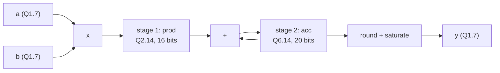

# 12 - Arithmetic blocks

**Reading time:** about 30 minutes.

## Goals

After this chapter you can:

- choose the right width for sums and products, and keep carries,
- write adders and know when to trust the `+` operator,
- write correct signed multipliers, combinational and sequential,
- work with fixed-point numbers: Q format, rounding and saturation,
- build a pipelined multiply-accumulate (MAC) unit.

## 1. Widths grow

Every arithmetic operation can need more bits than its inputs:

| Operation | Inputs | Result width |
|---|---|---|
| `a + b` | N and N bits | N + 1 |
| sum of K values | N bits each | N + ceil(log2(K)) |
| `a * b` | N and M bits | N + M |
| `a - b` (unsigned) | N bits | N bits + a borrow bit |

Verilog does not grow widths for you (chapter 03). You must declare the
target wide enough:

```verilog
wire [8:0]  sum  = a + b;     // 8 + 8 bits -> 9 bits
wire [15:0] prod = a * b;     // 8 x 8 bits -> 16 bits
reg  [19:0] acc;              // 16 products of 16 bits -> 16 + 4 = 20 bits
```

The extra bits of an accumulator are called **guard bits**.

## 2. Adders

### Ripple carry

A chain of full adders (chapter 01 and 07). Simple and small, but the carry
must travel through every bit: the delay grows linearly with the width.

### Carry lookahead

Files: [`examples/12-arithmetic-blocks/cla-adder/`](../examples/12-arithmetic-blocks/cla-adder/)

Two signals per bit tell what the bit does with a carry:

```verilog
wire [3:0] g = a & b;   // generate: makes a carry by itself
wire [3:0] p = a ^ b;   // propagate: passes an incoming carry on
```

Then each carry can be written directly from the inputs, without waiting:

```verilog
assign c[1] = g[0] | (p[0] & c[0]);
assign c[2] = g[1] | (p[1] & g[0]) | (p[1] & p[0] & c[0]);
...
assign sum  = p ^ c[3:0];
```

### In practice: write `+`

```verilog
assign {cout, sum} = a + b + cin;
```

FPGAs have a dedicated, very fast **carry chain** next to the LUTs, and `+`
maps onto it. ASIC tools choose a fast adder architecture for the timing you
ask for. Hand-written adders are for learning, or for special cases.

## 3. Multipliers

Files: [`examples/12-arithmetic-blocks/multipliers/`](../examples/12-arithmetic-blocks/multipliers/)

### Combinational, with `*`

```verilog
wire        [15:0] p_u = a * b;                    // unsigned
wire signed [15:0] p_s = $signed(a) * $signed(b);  // signed
```

FPGA tools map `*` to **DSP blocks** (hard multipliers, typically 18 x 18
or 18 x 25 bits). A multiplier made from LUTs instead is large and slow.

### The signed trap

```verilog
wire        [7:0]  a, b;          // two's complement values, but declared unsigned
wire signed [15:0] p = a * b;     // WRONG: the multiply is unsigned
```

The target is signed, but that does not matter: the **operands** decide.
`-3` is `8'hFD`, read as 253, and `253 * 5 = 16'h04F1` instead of `-15 =
16'hFFF1`. Fix: `$signed(a) * $signed(b)`, or declare the inputs `signed`.
Exercise 12.1 is exactly this bug.

### Sequential shift and add

```verilog
// one step per clock cycle
acc    <= acc + (mplier[0] ? mcand : 16'd0);
mcand  <= mcand << 1;
mplier <= mplier >> 1;
```

One adder, a few registers, 8 cycles per product. This trades **time for
area**, a decision you meet in every hardware design.

## 4. Fixed-point numbers

Many FPGA designs (filters, control loops, neural networks) do not need
floating point. They use **fixed-point** numbers: integers with an imagined
binary point.

**Q notation:** `Qm.n` has `m` integer bits (including the sign) and `n`
fraction bits. The value is `integer / 2^n`.

| Format | Bits | Range | Step |
|---|---|---|---|
| Q1.7 | 8 | -1.0 .. +0.992 | 1/128 |
| Q1.15 | 16 | -1.0 .. +0.99997 | 1/32768 |
| Q8.8 | 16 | -128.0 .. +127.996 | 1/256 |

```text
Q1.7:  0100_0000 = 64/128  =  0.5
       1100_0000 = -64/128 = -0.5
       1000_0000 = -128/128 = -1.0
```

### Rules for arithmetic

- **Addition:** both operands need the same `n` (align the binary points).
  The result has the same `n` and one more integer bit.
- **Multiplication:** `Qa.b x Qc.d = Q(a+c).(b+d)`. The fraction bits add up:
  Q1.7 x Q1.7 = Q2.14.
- **Back to the original format:** drop fraction bits with an arithmetic shift
  right (`>>> 7`), then reduce the integer bits.

### Rounding

Dropping bits with `>>>` rounds **toward minus infinity** (it is `floor`).
Over many operations this adds a bias. **Round to nearest** by adding half an
LSB of the result first:

```verilog
wire signed [20:0] rounded = acc + 21'sd64;      // half of 2^7
wire signed [13:0] shifted = rounded >>> 7;
```

### Saturation

When a result does not fit, wrapping around is terrible: a large positive
value becomes a large negative one. **Saturate** instead:

```verilog
assign y = (shifted >  14'sd127) ? 8'sd127  :
           (shifted < -14'sd128) ? -8'sd128 :
           shifted[7:0];
```

## 5. Example: a pipelined fixed-point MAC

Files: [`examples/12-arithmetic-blocks/mac-fixed-point/`](../examples/12-arithmetic-blocks/mac-fixed-point/)



```verilog
// stage 1
always @(posedge clk) begin
  v1   <= valid;
  f1   <= first;
  prod <= a * b;                  // a, b declared signed
end

// stage 2
always @(posedge clk) begin
  acc_valid <= v1;
  if (v1) acc <= f1 ? prod : acc + prod;
end
```

Notes:

- The control signals (`valid`, `first`) travel through the pipeline **with**
  the data. Every stage needs its own copy.
- `prod` and `acc` are both signed, so `acc + prod` sign-extends `prod`
  automatically.
- The testbench models the arithmetic with plain integers and division,
  and prints real numbers only to make the results readable:

```text
0.5*0.5 + 0.25*(-1.0) = 0.000000 (acc=0, y=0)
8 x 0.99^2 = 7.875488 -> y = 127 (saturated)
```

## 6. Pipelining arithmetic

A long chain of adders and multipliers between two registers is a long
critical path (chapter 11). **Pipelining** cuts the chain with registers:

```text
without pipeline:  reg -> [mult] -> [add] -> reg           1 long path
with pipeline:     reg -> [mult] -> reg -> [add] -> reg    2 short paths
```

The clock can then be faster. The price: more registers, and results come
out later (**latency**). The **throughput** (results per clock cycle) stays
one per cycle. DSP blocks on FPGAs have optional internal pipeline registers
for this reason. Chapter 13 shows a pipelined adder tree.

## 7. Common mistakes

### Mistake 1: a signed product from unsigned operands

Wrong: `wire signed [15:0] p = a * b;` with unsigned `a`, `b`.
Fix: `wire signed [15:0] p = $signed(a) * $signed(b);`

### Mistake 2: mixing a signed value and an unsigned constant

Wrong:

```verilog
wire signed [19:0] acc_next = acc + 8'd1;   // 8'd1 is unsigned: acc is NOT sign-extended
```

Fix: `acc + 20'sd1`, or `acc + 1` (an unsized decimal is signed).

### Mistake 3: an accumulator without guard bits

Wrong:

```verilog
reg signed [15:0] acc;     // the same width as one product
always @(posedge clk) acc <= acc + prod;    // overflows after two large products
```

Fix: add `ceil(log2(K))` bits for K products.

### Mistake 4: `>>` instead of `>>>` on signed values

Wrong: `y = acc >> 7;` (fills with zeros: negative values become large positive).
Fix: `y = acc >>> 7;` with `acc` declared signed.

### Mistake 5: rounding by truncation

`>>>` alone always rounds down. For a filter with many taps, the error adds
up to a visible DC offset. Add half an LSB before the shift.

### Mistake 6: forgetting to pipeline control signals

Wrong:

```verilog
always @(posedge clk) prod <= a * b;
always @(posedge clk) if (valid) acc <= acc + prod;   // valid belongs to the NEXT product
```

Fix: delay `valid` by one stage (`v1 <= valid;`) and use `v1` in stage 2.

## 8. Exercises

1. [`ex1-signed-multiply`](../exercises/12-arithmetic-blocks/ex1-signed-multiply/):
   fix a "signed" multiplier that multiplies unsigned values.
2. [`ex2-fixed-point-gain`](../exercises/12-arithmetic-blocks/ex2-fixed-point-gain/):
   a Q1.15 gain stage with rounding and saturation.
3. (No solution.) Extend the MAC example to a 4-tap FIR filter: keep the last
   four samples in a shift register and multiply them with four constant
   coefficients.

## Summary

- Sums need N+1 bits, products N+M bits, accumulators extra guard bits.
- Write `+` and `*`: the tools map them to carry chains and DSP blocks.
- A product is signed only if both operands are signed.
- Fixed point: Q formats, fraction bits add in a product, round by adding
  half an LSB, saturate instead of wrapping.
- Pipelining shortens the critical path. Control signals must be pipelined
  with the data.

Next: [13 - Towards FPGA design](13-towards-fpga.md).
