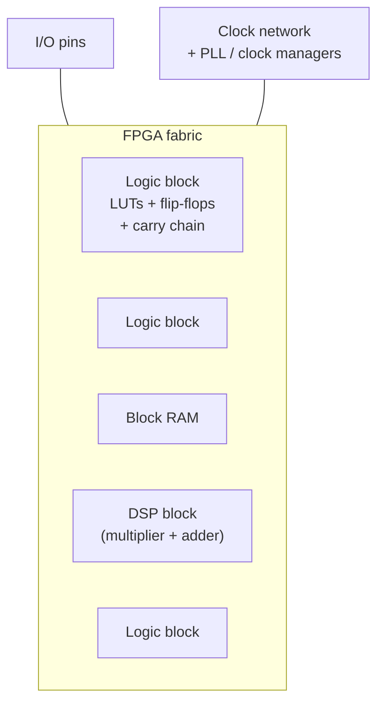
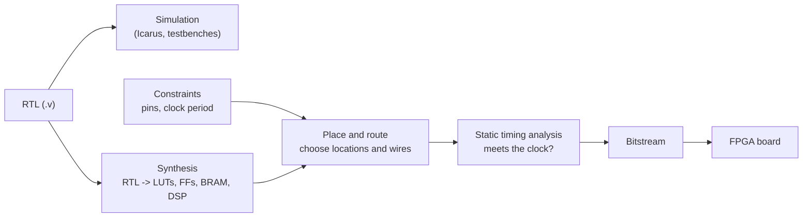

# 13 - Towards FPGA design

**Reading time:** about 30 minutes.

## Goals

After this chapter you can:

- describe the main building blocks of an FPGA,
- model a LUT in Verilog and compute its INIT value from a truth table,
- predict roughly what hardware your code becomes,
- use pipelining to make a design run at a higher clock frequency,
- follow the steps from Verilog code to a configured FPGA.

This chapter is general. The ideas apply to FPGAs from every vendor.

## 1. What is inside an FPGA

An FPGA is a large grid of small, configurable blocks, connected by a
programmable routing network:



| Block | What it does | Verilog that maps to it |
|---|---|---|
| **LUT** (4 or 6 inputs) | any combinational function of its inputs | `assign`, `always @(*)` |
| **Flip-flop** | one bit of state, next to each LUT | `always @(posedge clk)` |
| **Carry chain** | fast ripple carry for adders and counters | `+`, `-`, comparisons |
| **Block RAM** | kilobits of memory with synchronous ports | memory arrays with registered read (chapter 08) |
| **DSP block** | multiplier, adder, accumulator | `*`, MAC patterns (chapter 12) |
| **Clock network** | low-skew wires that carry clocks | the `clk` in `@(posedge clk)` |
| **I/O blocks** | pins, I/O standards, I/O registers | top-level ports |

The configuration (the **bitstream**) sets every LUT's content, every
routing switch and every block's mode.

## 2. The LUT: the heart of the logic

Files: [`examples/13-towards-fpga/lut-model/`](../examples/13-towards-fpga/lut-model/)

A LUT is a tiny ROM. Its inputs are the address, and its contents (INIT)
are the truth table:

```verilog
module lut4 #(parameter [15:0] INIT = 16'h0000) (
  input wire i0, i1, i2, i3,
  output wire o
);
  assign o = INIT[{i3, i2, i1, i0}];
endmodule
```

To build a function, write its truth table. Bit `n` of INIT is the output
for the input combination `n = {i3,i2,i1,i0}`. For the sum of a full adder
(`a ^ b ^ cin` on i0, i1, i2):

```text
n          7 6 5 4 3 2 1 0
sum        1 0 0 1 0 1 1 0    -> 8'h96, repeated for i3: INIT = 16'h9696
```

Important consequences:

- **Any** function of up to 4 inputs (6 on most modern FPGAs) costs one LUT.
  `a ^ b ^ c ^ d` and `a & b & c & d` have the same cost and delay.
- A function of more inputs needs several LUTs in **levels**. A 16-input
  AND needs two levels of 4-input LUTs (or two of 6-input LUTs).
- Each LUT level adds delay, and the routing between levels adds even more.
  **Logic levels** between registers are the main factor for the clock speed.

## 3. How code maps to hardware

You do not need to place LUTs by hand. But you should be able to predict the
rough shape of what you get:

| Code | Hardware |
|---|---|
| `assign y = a & b \| c;` | one LUT |
| `always @(posedge clk) q <= d;` | one flip-flop per bit |
| `if (en) q <= d;` in a clocked block | flip-flop with clock enable |
| `case` with N items | a multiplexer: LUTs, log levels |
| `a + b` (N bits) | N LUTs plus the carry chain |
| `a * b` | a DSP block (or many LUTs for small or odd sizes) |
| `reg [7:0] m [0:1023]` with registered read | one block RAM |
| a `for` loop in `always @(*)` | one copy of the body per iteration |
| a latch from a missing `else` | a latch (avoid) |

Two tools help you see the result:

- `yosys -p "read_verilog file.v; synth; stat"` prints the cell count
  (`make lint` does this for every example).
- The FPGA vendor tool shows a schematic of the synthesized design and a
  utilization report (LUTs, flip-flops, BRAM, DSP).

## 4. Timing: why pipelining matters

From chapter 11: the clock period must be longer than the slowest path
between two registers:

```text
clock period >= clock-to-Q + (logic levels x delay) + routing + setup
```

If a design does not meet the target frequency, you have three choices:

1. **Use fewer logic levels** (better code, simpler logic).
2. **Pipeline:** insert registers in the long path.
3. **Lower the clock frequency.**

### Example: a pipelined adder tree

Files: [`examples/13-towards-fpga/pipelined-adder-tree/`](../examples/13-towards-fpga/pipelined-adder-tree/)

Adding eight values needs three levels of adders. Without pipelining, all
three are in one clock period:

```verilog
always @(posedge clk)
  sum <= d0 + d1 + d2 + d3 + d4 + d5 + d6 + d7;   // 3 adder levels per period
```

With a register after each level, each period holds one adder level:

```verilog
always @(posedge clk) begin
  for (k = 0; k < 4; k = k + 1)
    s1[k] <= din[16*k +: 8] + din[16*k + 8 +: 8];   // level 1
  s2[0] <= s1[0] + s1[1];                            // level 2
  s2[1] <= s1[2] + s1[3];
  sum   <= s2[0] + s2[1];                            // level 3
end
```

```text
cycle         1      2      3      4      5
input         X1     X2     X3     X4     X5
level 1 reg   -      X1     X2     X3     X4
level 2 reg   -      -      X1     X2     X3
sum           -      -      -      X1     X2     <- latency 3, one result per cycle
```

### Rules for pipelining

- Every signal that travels with the data (`valid`, `last`, tags) needs the
  **same** number of registers. Otherwise data and control get out of step.
- The **latency** grows, the **throughput** stays the same. Design the
  surrounding logic (and the testbench) for the new latency.
- Feedback loops (an accumulator, a state machine) cannot simply be
  pipelined, because the next value needs the current one. Keep loops short.
- Do not pipeline more than needed: every register costs a flip-flop and power.

## 5. From Verilog to a running FPGA



- **Constraints** tell the tools the clock frequency and which pin is which.
  Without a clock constraint, the timing report means nothing.
- **Synthesis warnings** are worth reading: latches, multiple drivers,
  removed logic ("signal X has no load"), width truncation.
- **Timing closure** is the work of making every path meet the clock period.
- On the board, internal signals can be watched with an embedded logic
  analyzer (vendor tools provide one).

Free tool flows exist for some FPGA families (Yosys with nextpnr), and every
vendor has a free edition of its tools for small and medium devices.

## 6. Good habits for FPGA designs

1. One clock if possible. More clocks need clock-domain-crossing logic.
2. Synchronous design: all flip-flops on the same edge of the same clock.
3. Synchronize every asynchronous input with two flip-flops (chapter 05).
4. Reset control logic. Do not reset large data paths and memories.
5. Register outputs to pins, and register inputs from pins.
6. Write memories and multipliers in the style the tools recognize
   (chapters 08 and 12), and check in the utilization report that they
   became BRAM and DSP.
7. Simulate first. Debugging on the board is much slower.

## 7. Common mistakes

### Mistake 1: a gated clock

Wrong:

```verilog
wire gclk = clk & en;
always @(posedge gclk) q <= d;
```

Why: the AND gate adds delay and glitches to the clock, and the tools cannot
use the clock network. Fix: `always @(posedge clk) if (en) q <= d;`

### Mistake 2: asynchronous read of a big memory

The memory becomes LUTs and flip-flops instead of a block RAM (chapter 08).
Register the read.

### Mistake 3: deep logic in one cycle

Wrong: a 32-bit multiplier, an adder and a comparator between two registers
at 200 MHz. Fix: pipeline, or let the DSP block use its internal registers.

### Mistake 4: forgetting to pipeline `valid`

The data comes out three cycles later, but `valid` one cycle later. Every
consumer gets the wrong data. Fix: delay control signals exactly like data.

### Mistake 5: no timing constraint

Without a clock constraint, the tool does not know the target, and a design
that "builds without errors" may fail on the board. Always constrain the clock.

## 8. Exercises

1. [`ex1-lut-init`](../exercises/13-towards-fpga/ex1-lut-init/):
   compute the INIT values of four LUT functions.
2. [`ex2-pipeline-it`](../exercises/13-towards-fpga/ex2-pipeline-it/):
   turn a one-cycle dot product into a three-stage pipeline.
3. (No solution.) Build an 8-input AND from 4-input LUTs only. How many LUTs
   and how many levels do you need? Then do the same for an 8-input XOR.

## Summary

- An FPGA is LUTs, flip-flops, carry chains, block RAM, DSP blocks and a
  clock network, connected by programmable routing.
- A LUT is a small ROM: any function of its inputs, INIT is the truth table.
- Logic levels between registers set the maximum clock frequency.
- Pipelining adds registers: higher frequency, more latency, same throughput.
  Delay control signals with the data.
- The flow is simulation, synthesis, place and route, timing analysis, bitstream.

Next: [14 - Debugging checklist](14-debugging-checklist.md).
