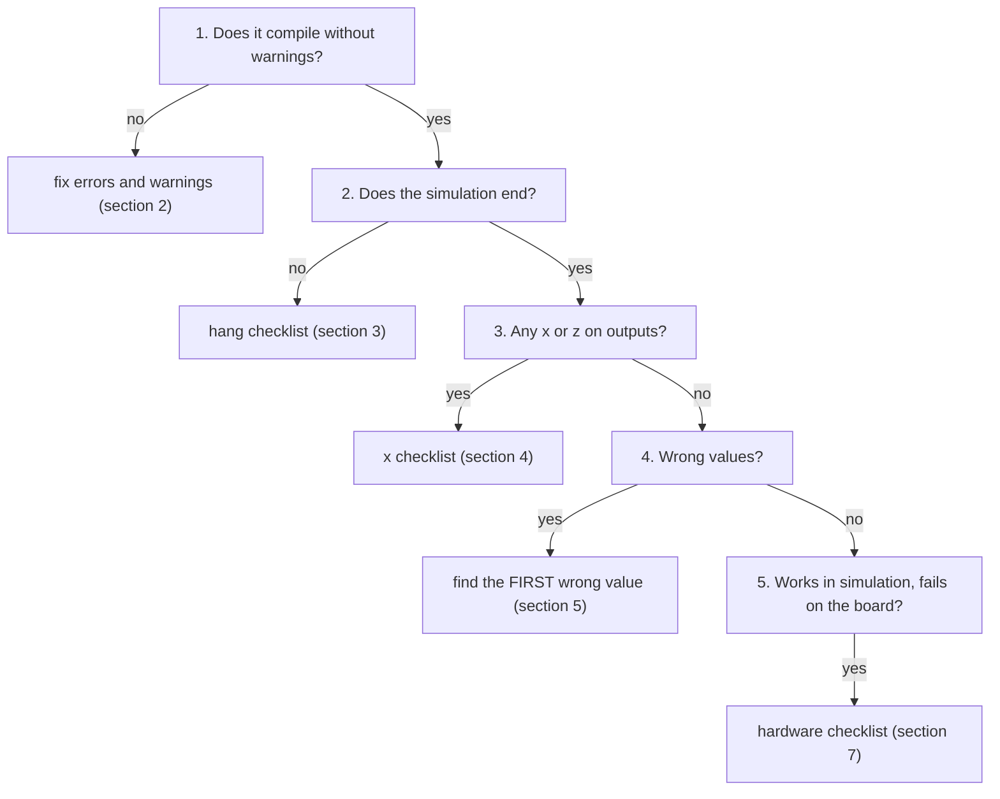

# 14 - Debugging checklist

**Reading time:** about 30 minutes (and much longer the first time you use it for real).

## Goals

After this chapter you can:

- debug in a fixed order instead of guessing,
- recognize the most common Icarus error and warning messages,
- find the cause of hangs, `x` values, wrong values and off-by-one-cycle errors,
- use `$display`, waveforms and small test cases efficiently.

## 1. The method



Three rules make debugging fast:

1. **Look at the first error.** Later errors are often consequences.
2. **Make the failing case small and repeatable.** Fix the seed, shorten the
   test, find the smallest input that fails.
3. **Change one thing at a time,** and run the test after each change.

## 2. Compile errors and warnings

Always compile with `-Wall`. Optionally run `make lint` (Verilator and Yosys),
which finds even more. Common Icarus messages:

| Message (shortened) | Usual cause | Chapter |
|---|---|---|
| `syntax error` (on the line after the real problem) | missing `;`, missing `end`, `);` after the header | 01 |
| `Unknown module type: mux2` | a source file is missing in the `iverilog` command | 00 |
| `warning: implicit definition of wire 'x'` | typo in a port connection | 01 |
| `Net x is not defined in this context` | same typo with `` `default_nettype none `` | 01 |
| `Port 3 (sum) of half_adder expects 1 bits, got 4` | width mismatch on a port | 01 |
| `y is not a valid l-value` | a `wire` assigned in an `always` block | 02 |
| `reg y; cannot be driven by primitives or continuous assignment` | a `reg` driven by `assign` | 01 |
| `Concatenation operand ... has indefinite width` | an unsized number in `{ }` | 02 |
| `Part select expressions must be constant` | `x[i+7:i]`, use `x[i +: 8]` | 02 |
| `Constant bit select [8] is after vector sum[7:0]` | index out of range | 03 |
| `$readmemh: Unable to open file` | wrong folder or file name | 08 |

Verilator adds warnings such as `LATCH` (missing `else` or `default`),
`BLKSEQ` (`=` in a clocked block), `WIDTHTRUNC` and `WIDTHEXPAND`
(width mismatches) and `UNUSED`. Each one is worth a look.

## 3. The simulation hangs

| Check | Fix |
|---|---|
| Is there a `$finish` (or `$fatal`) at the end of the test? | add it |
| Does a `while` or `wait` wait for a signal that never comes? | add a watchdog / cycle limit (chapter 09) |
| Is there a combinational loop (`assign a = ~a;`, or two blocks feeding each other)? | break it with a register |
| Is there an `always` block without any event or delay (`always x = y;`)? | `always @(*)` |
| Does a `forever` loop have no delay inside? | add `#` or `@` |

To stop a hanging run, press `Ctrl+C` in `vvp`, then type `finish` at the
`>` prompt. To find where it hangs, add `$display("%t: step 3", $time);`
lines and see which one is printed last.

## 4. x or z on outputs

`x` is a clue. Follow it **backwards** in the waveform: which input of the
block producing it is `x`? Repeat until you find the source.

| Symptom | Usual cause |
|---|---|
| a register is `x` from the start | no reset, or reset never active, or no clock |
| everything is `x` | the clock is `x` (not initialized) or not connected |
| a signal is `z` | not driven: unconnected port, typo, missing `assign` |
| `x` appears after some time | two drivers disagree, or `x` data was stored |
| part of a bus is `x` or `z` | width mismatch on a port connection |
| memory reads give `x` | address out of range, `$readmemh` failed, never written |
| `x` in arithmetic | one `x` bit makes the whole sum `x` |

Testbench helpers:

```verilog
if (^y === 1'bx) $display("ERROR: x on y at %t", $time);   // any bit x or z?
$display("%b", y);                                          // %b shows which bits
```

## 5. Wrong values

Find the **first** cycle where the value is wrong. Print inputs and
outputs at that time, or put a marker in the waveform. Then check, in this order:

1. **Widths.** Is a result truncated? Is a carry lost? Are the operands
   extended the way you think? (chapter 03)
2. **Signedness.** Is one operand unsigned in a signed expression? `>>`
   instead of `>>>`? (chapters 03 and 12)
3. **Cycle timing.** Is the value right but one cycle early or late?
   Draw a timing table: input, each register, output, for 4 cycles.
4. **Control.** Does an enable, valid or select have the expected value at
   that edge? Is a priority in an `if` chain wrong?
5. **State machine.** Look at the state register. Is a transition missing?
   Is the FSM stuck in a state?
6. **The testbench.** Is the reference model right? Is the check done at the
   right time? A wrong testbench is as common as a wrong design.

### Off-by-one-cycle errors

Very common with non-blocking assignments and pipelines. The value in the
waveform is right, but one cycle away from where you expect it. Ask for each
register: "at which edge was it written, and which values did it read?"

## 6. Races and timing in simulation

Suspect a race when:

- the result changes when you reorder `always` blocks or files,
- a value is right in `$strobe` but wrong in `$display`,
- the testbench changes inputs at the same edge where the DUT samples them,
- you see `=` in a clocked block.

Fix with the rules of chapters 05 and 11: `<=` in clocked blocks, inputs
change at the falling edge, no `#` delays in RTL.

## 7. Works in simulation, fails on the board

| Check | Notes |
|---|---|
| Synthesis warnings: latches, multiple drivers, removed logic, truncation | read all of them |
| Timing report: does every path meet the clock constraint? | is the clock constrained at all? |
| Pin assignment: correct pins and I/O standard? | constraints file |
| Reset: correct polarity (active low button?), synchronized? | many boards have active-low buttons |
| Asynchronous inputs: synchronized with two flip-flops? | buttons, UART RX, other clocks |
| Buttons: debounced? | chapter 05 |
| Initial values that only exist in simulation? | chapter 10 |
| x-optimism: simulation chose a branch, hardware did not? | chapter 10 |
| Clock: correct frequency, PLL locked? | wait for the lock signal |

For internal signals, use the vendor's embedded logic analyzer, or route a
signal to an LED or a spare pin.

## 8. Techniques

### Print with context

```verilog
$display("%t state=%0d cnt=%0d din=%h", $time, dut.state, dut.cnt, din);
```

Hierarchical names (`dut.state`) let the testbench see inside the design
without changing it.

### Waveforms with a plan

Do not add all signals. Add the inputs, the outputs, the state register and
the signals on the path you suspect. In GTKWave, use markers at the first
error time, and save the signal list (`File > Write Save File`) so you can
reload it after each run.

### Make the case small

- Fix the random seed (`+seed=N`) and print it.
- Cut the test to the first failing transaction.
- Test the sub-block alone with its own small testbench.

### Assertions in the testbench

Check rules continuously, not only at the end:

```verilog
always @(posedge clk)
  if (!rst && full && empty) begin
    $display("ERROR at %t: full and empty at the same time", $time);
    errors = errors + 1;
  end
```

The SystemVerilog appendix shows real `assert` statements.

### Explain it to someone

Explain the code line by line to a colleague (or to a rubber duck). You will
often find the bug while you speak.

## 9. A printable checklist

```text
COMPILE    [ ] -Wall, zero warnings      [ ] make lint read
           [ ] `default_nettype none     [ ] all files in the command
HANG       [ ] $finish / watchdog        [ ] no combinational loop
X / Z      [ ] clock initialized         [ ] reset applied and released
           [ ] all inputs connected      [ ] widths match on ports
WRONG      [ ] first error found         [ ] widths and carries
           [ ] signed operands           [ ] timing table drawn
           [ ] control signals checked   [ ] testbench model checked
RACE       [ ] <= in clocked blocks      [ ] inputs change at negedge
BOARD      [ ] synthesis warnings        [ ] timing met, clock constrained
           [ ] pins, reset polarity      [ ] inputs synchronized
```

## 10. Exercise

1. [`ex1-debug-me`](../exercises/14-debugging-checklist/ex1-debug-me/): a moving
   average filter with three bugs. Use the checklist, and write down the
   symptom, cause and fix of each bug.
2. (No solution.) Pick any example from this repository, add a bug on purpose
   (a width, a blocking assignment, a missing `else`), and ask a friend to find it
   with this checklist.

## Summary

- Debug in order: compile, hang, x, wrong values, hardware.
- Read the first error. Make the failing case small and repeatable.
- Follow `x` backwards to its source.
- Check widths, signedness and cycle timing before anything else.
- Suspect races when block order matters. Suspect timing, resets and
  synchronizers when only the board fails.

Next: the [cheat sheet](cheat-sheet.md) and the
[SystemVerilog appendix](appendix-systemverilog.md).
