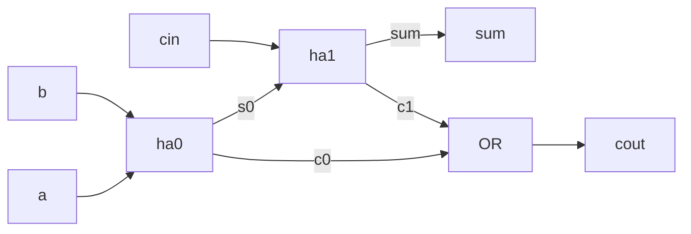

# Example: full adder from two half adders

Shows how one module uses other modules (hierarchy).

| File | What it is |
|---|---|
| `half_adder.v` | `sum = a ^ b`, `carry = a & b` |
| `full_adder.v` | Two `half_adder` instances and one OR gate |
| `tb_full_adder.v` | Tries all 8 input combinations |



## Run

```bash
make run DIR=examples/01-modules-and-ports/full-adder
```

## What to look at

- In GTKWave, open `tb_full_adder` then `dut`, then `ha0` and `ha1`.
  Each instance has its own copy of the half adder signals.
- The testbench prints `dut.s0`, a wire inside the design. This is a
  *hierarchical name*.
