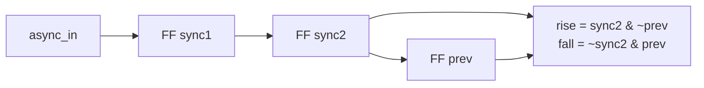

# Example: synchronizer and edge detector

Turns an outside signal into clean one-cycle pulses.



## Run

```bash
make run DIR=examples/05-sequential-logic/edge-detector
```

## Waveform

```text
clk       _/~\_/~\_/~\_/~\_/~\_/~\_
async_in  ___/~~~~~~~~~~~~~~~~~~~~~
sync1     _____/~~~~~~~~~~~~~~~~~~~
sync2     _________/~~~~~~~~~~~~~~~
prev      _____________/~~~~~~~~~~~
rise      _________/~~~\___________
```

## Notes

- **Never** use an asynchronous input directly in logic. Always pass it
  through two flip-flops first.
- The simulator cannot show metastability: it has only 0, 1, x and z.
  The synchronizer is there for the real hardware.
- A mechanical button also bounces for some milliseconds. Exercise 05.2
  adds a debouncer.
