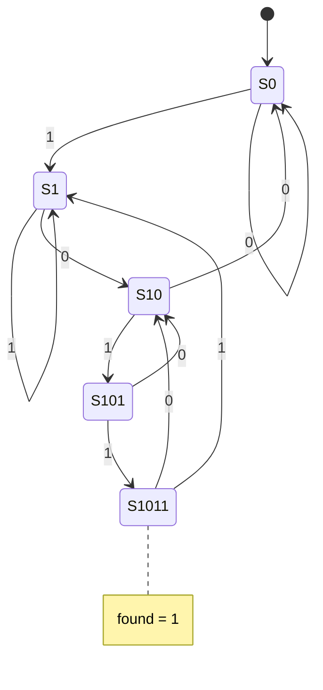

# Example: 1011 sequence detector, Moore and Mealy

## Moore state diagram



The Mealy version has no `S1011` state. Its output is
`found = (state == S101) && din`.

## Run

```bash
make run DIR=examples/06-fsm/sequence-detector
```

## Timing difference

```text
clk edge      1  2  3  4  5  6  7  8
din           1  0  1  1  0  1  1  0
mealy found   0  0  0  1  0  0  1  0   same cycle as the last 1
moore found   0  0  0  0  1  0  0  1   one cycle later
```

The Mealy output reacts faster, but it is combinational from the input,
so a glitch on `din` can reach `found`. The Moore output comes straight
from a register state and is clean.
