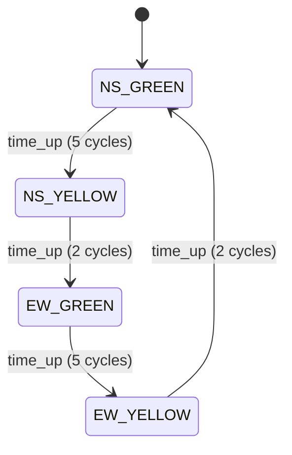

# Example: traffic light controller (Moore FSM with a timer)



| File | What it is |
|---|---|
| `traffic_light.v` | Three-block FSM: registers, next-state logic, output logic |
| `tb_traffic_light.v` | Checks safety (one road always red), phase order and phase length |

## Run

```bash
make run DIR=examples/06-fsm/traffic-light
```

## What to look at

- The **timer** is a small counter next to the state register. Many real
  FSMs look like this: a state machine plus a counter.
- The output block starts with "both red". If the state is ever illegal,
  the output is safe.
- The testbench does not copy the FSM. It checks **properties**:
  safety, order and timing. That is a powerful way to test control logic.
