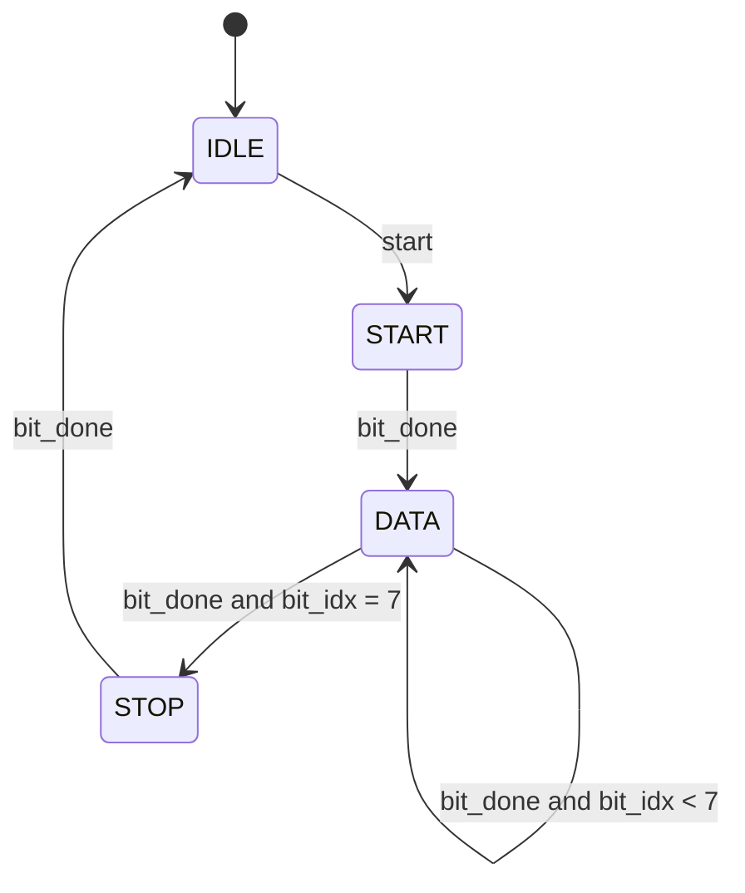

# Example: UART transmitter (FSM plus datapath)



## Frame for 8'h55 (LSB first)

```text
tx:  1 1 | 0 | 1 0 1 0 1 0 1 0 | 1 | 1 1
     idle start  d0 ........ d7  stop idle
```

## Run

```bash
make run DIR=examples/06-fsm/uart-tx
```

## What to look at

- `tx` is a **register**. A UART line must not glitch, so it should not come
  from combinational logic.
- The FSM decides **what** to send. The counters `clk_cnt` and `bit_idx`
  decide **when**. Most real controllers are split this way.
- The testbench receiver uses only the `tx` line and delays (`#`), not the
  DUT's internal signals. It samples in the middle of each bit, like real
  hardware. It also sets `data` to `x` right after the start pulse to prove
  that the transmitter copied the data at the right moment.
- `parameter CLKS_PER_BIT` is set to 8 by the testbench with `#(...)`.
  Chapter 07 covers parameters.
