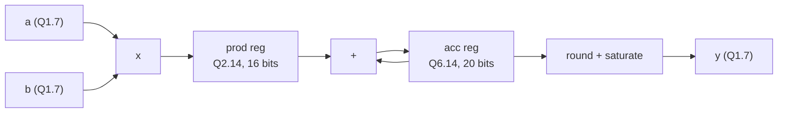

# Example: pipelined fixed-point multiply-accumulate (MAC)

A MAC computes dot products, `sum(a[k] * b[k])`, the core of FIR filters,
matrix multiplication and neural networks.



## Run

```bash
make run DIR=examples/12-arithmetic-blocks/mac-fixed-point
```

```text
0.5*0.5 + 0.25*(-1.0) = 0.000000 (acc=0, y=0)
8 x 0.99^2 = 7.875488 -> y = 127 (saturated)
```

## What to look at

- **Widths grow:** 8-bit x 8-bit gives 16 bits. Adding 16 such products
  needs 4 more **guard bits**: 20 bits for the accumulator.
- **The binary point moves:** Q1.7 x Q1.7 = Q2.14. To return to Q1.7, drop
  7 fraction bits.
- **Rounding:** add half an LSB (64) before the shift. Without it the result
  is always rounded down.
- **Saturation:** clamp to the output range instead of wrapping around.
- **Pipelining:** the multiplier and the adder are in different stages,
  so each clock period contains only one of them.
- The testbench model uses plain integers and division, not shifts, and it
  prints real numbers only to make the values readable.
