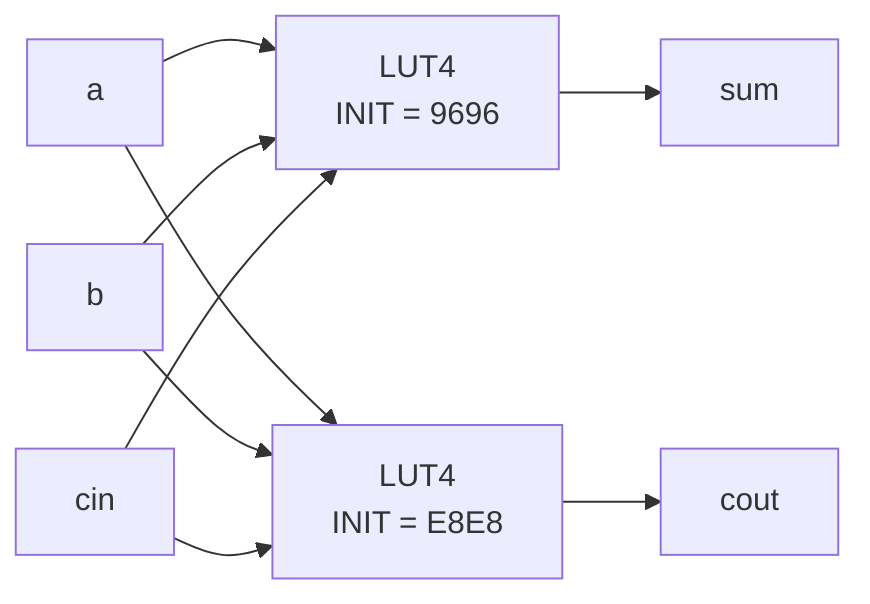

# Example: a LUT model and a full adder made of two LUTs

| File | What it is |
|---|---|
| `lut4.v` | `o = INIT[{i3, i2, i1, i0}]`: a 16-bit ROM with a 16-to-1 mux |
| `full_adder_luts.v` | `sum` and `cout` as two `lut4` instances with INIT values |
| `tb_full_adder_luts.v` | Checks all 8 input combinations |



## Run

```bash
make run DIR=examples/13-towards-fpga/lut-model
```

## What to remember

- Any function of up to 4 (or 6) inputs costs **one LUT**, no matter how
  complex it looks: an XOR of 4 bits and an AND of 4 bits cost the same.
- A function with more inputs needs several LUTs in **levels**. Each level
  adds delay. Counting LUT levels is a good first estimate of the speed.
- `full_adder_luts.v` explains how to compute INIT from a truth table.
