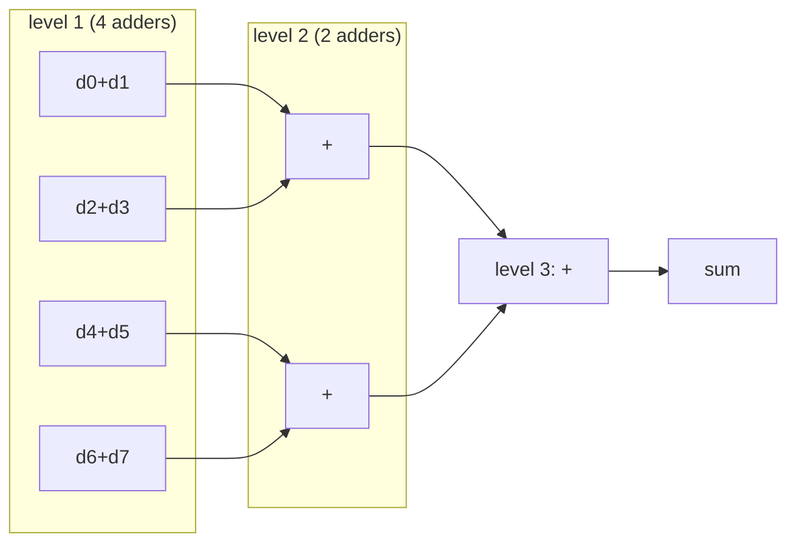

# Example: pipelined adder tree

Sum of eight 8-bit values.



| Version | Registers | Adder levels per clock period | Latency |
|---|---|---|---|
| `adder_tree_comb` | output only | 3 | 1 cycle |
| `adder_tree_pipe` | after every level | 1 | 3 cycles |

## Run

```bash
make run DIR=examples/13-towards-fpga/pipelined-adder-tree
```

## What to look at

- `valid` goes through the same number of registers as the data.
- The testbench keeps a small queue of expected values and shifts it at
  every edge, like the pipeline. That is the usual way to check pipelines.
- On an FPGA, the pipelined version can run at a much higher clock
  frequency. Synthesize both with your FPGA tool and compare the timing reports.
