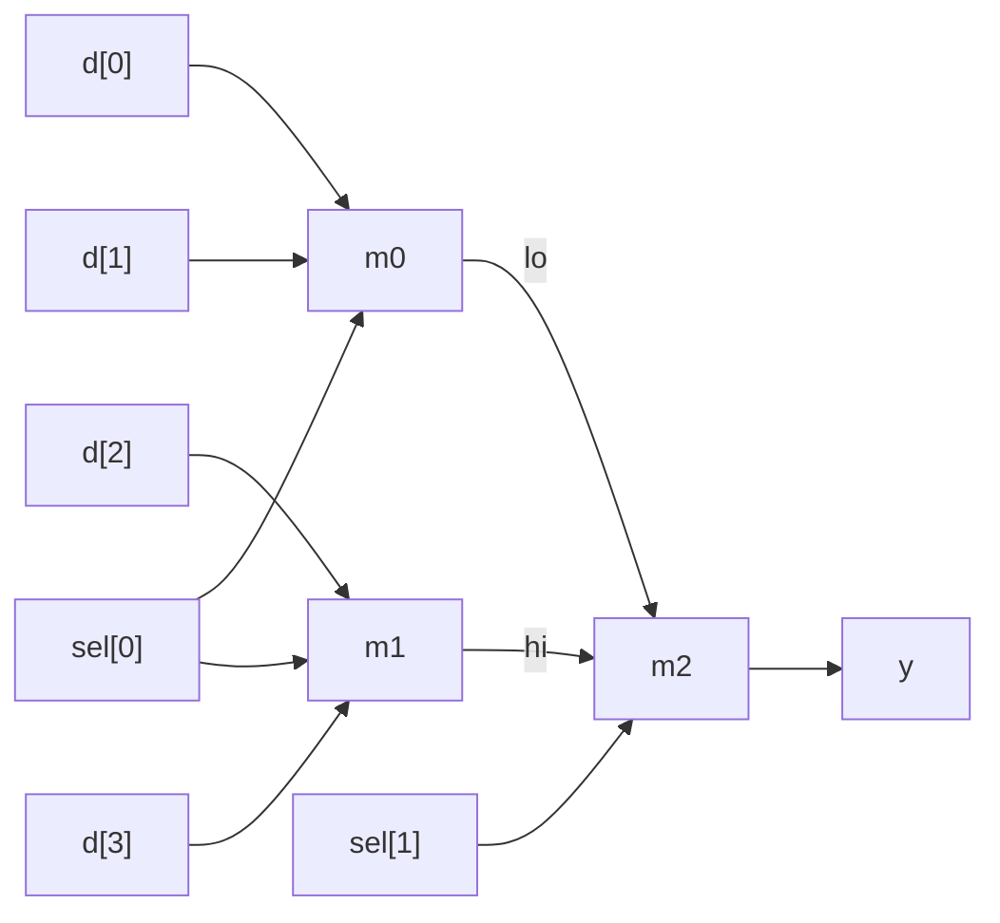

# Exercise 01.1: 4-to-1 multiplexer from three 2-to-1 multiplexers

## Task

Complete `mux4.v`. Use **three instances** of the given `mux2` module.
Do not use `? :` or `case` in `mux4.v`.

| Port | Direction | Width | Meaning |
|---|---|---|---|
| `d` | input | 4 | data inputs `d[0]` to `d[3]` |
| `sel` | input | 2 | `y = d[sel]` |
| `y` | output | 1 | selected bit |



## Hints

- You need two internal wires (for example `lo` and `hi`).
- `mux2` has ports `a`, `b`, `sel`, `y`. Its output is `a` when `sel = 0`.
- Connect ports by name.

## Run

```bash
make run DIR=exercises/01-modules-and-ports/ex1-mux4-from-mux2
```
