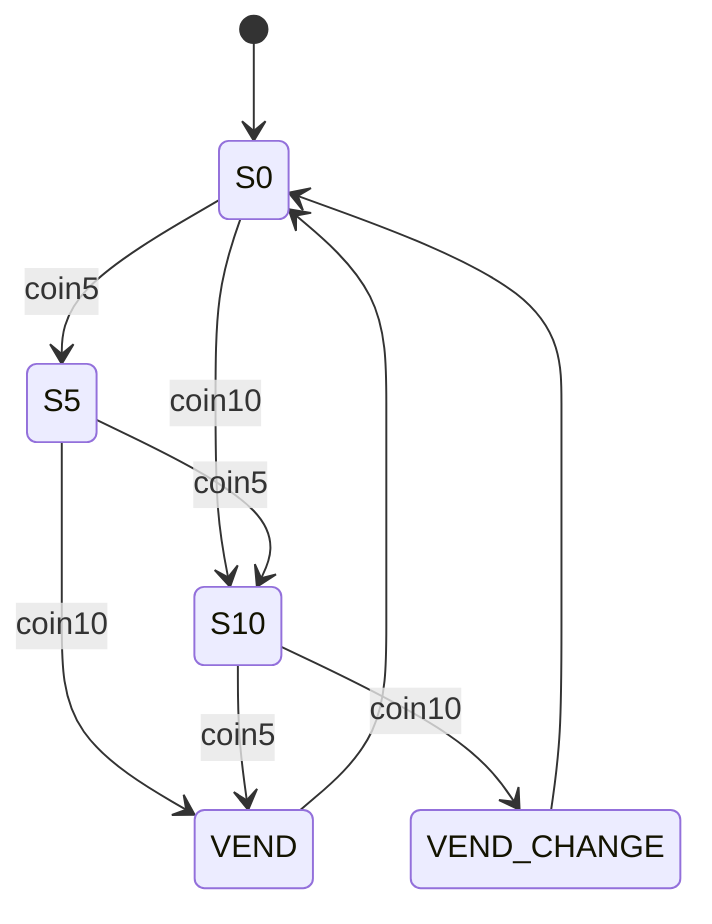

# Exercise 06.1: vending machine (Moore FSM)

A machine sells a drink for **15** cents. It accepts 5-cent and 10-cent coins.

## Task

Complete `vending.v` as a Moore FSM.

Inputs (sampled at the rising edge of `clk`):

- `coin5`: a 5-cent coin was inserted (a 1-cycle pulse),
- `coin10`: a 10-cent coin was inserted (a 1-cycle pulse).
  The testbench never sets both in the same cycle.

Outputs (Moore: they depend only on the state):

- `vend`: 1 for one cycle when the drink is given,
- `change`: 1 for one cycle together with `vend`, when 20 cents were paid
  (the machine returns 5 cents).

Suggested states:

| State | Meaning | vend | change |
|---|---|---|---|
| `S0` | 0 cents | 0 | 0 |
| `S5` | 5 cents | 0 | 0 |
| `S10` | 10 cents | 0 | 0 |
| `VEND` | 15 paid, give the drink | 1 | 0 |
| `VEND_CHANGE` | 20 paid, give drink and 5 back | 1 | 1 |

From `VEND` and `VEND_CHANGE`, always go back to `S0` (coins in that cycle
are ignored, and the testbench does not send any).



## Hints

- Use the three-block style from chapter 06: state register, next-state
  logic with a default, output logic.
- Synchronous reset `rst` goes to `S0`.

## Run

```bash
make run DIR=exercises/06-fsm/ex1-vending-machine
```
