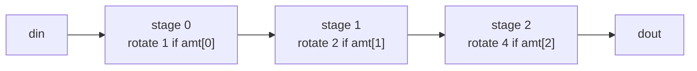

# Exercise 07.2: barrel rotator with a generate loop

A barrel shifter shifts by any amount in one clock cycle. It is built from
`log2(WIDTH)` stages. Stage `k` rotates by `2^k` positions if bit `k` of the
amount is 1, otherwise it passes its input through.



## Task

Complete `rotl.v`: rotate `din` **left** by `amt` positions.

```text
WIDTH = 8: din = 1000_0001, amt = 1 -> dout = 0000_0011
           din = 1000_0001, amt = 4 -> dout = 0001_1000
```

| Parameter | Meaning |
|---|---|
| `WIDTH` | data width, a power of two (default 8) |
| `SHIFT_W` | width of `amt`, equal to `log2(WIDTH)` (default 3) |

## Rules

- Use a `generate for` loop with one iteration per stage.
- Use an array of wires for the stage outputs: `wire [WIDTH-1:0] stage [0:SHIFT_W];`
- Do not use the `<<` or `>>` operators.

## Hint

Rotating `x` left by `s` positions (with a constant `s`) is a concatenation:
`{x[WIDTH-1-s:0], x[WIDTH-1:WIDTH-s]}`.

## Run

```bash
make run DIR=exercises/07-parameters-generate-hierarchy/ex2-barrel-rotator
```
