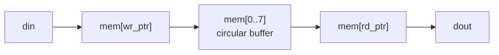

# Exercise 08.2: synchronous FIFO

A FIFO (first in, first out) is a small queue. It connects blocks that
produce and consume data at different moments. This one uses one clock for
both sides ("synchronous FIFO").

## Task

Complete `fifo8.v`: 8 entries of 8 bits.

| Port | Width | Meaning |
|---|---|---|
| `clk`, `rst` | 1 | clock, synchronous reset (FIFO becomes empty) |
| `wr_en` | 1 | write `din` at this edge, **if not full** |
| `din` | 8 | write data |
| `rd_en` | 1 | read one entry at this edge, **if not empty** |
| `dout` | 8 | the entry read at the last edge (a register) |
| `full` | 1 | 1 when 8 entries are stored |
| `empty` | 1 | 1 when no entry is stored |
| `count` | 4 | number of stored entries, 0 to 8 |

Rules:

- `full` and `empty` describe the state **before** the edge. A write while
  `full` is ignored. A read while `empty` is ignored.
- A read and a write in the same cycle both happen (if allowed), and
  `count` stays the same.
- `dout` changes only on a read. It holds the oldest entry, removed at that edge.



## Hints

- Use a memory `reg [7:0] mem [0:7]`, a write pointer and a read pointer
  (3 bits each: they wrap from 7 to 0 by themselves), and a `count` register.
- `full = (count == 8)`, `empty = (count == 0)`.
- Compute two helper wires first: `do_write = wr_en && !full` and
  `do_read = rd_en && !empty`.

## Run

```bash
make run DIR=exercises/08-memories/ex2-sync-fifo
```
